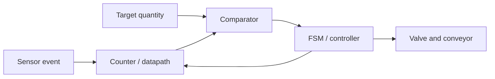

@@NOTE
Digital Abstraction and System Design|数字抽象与系统设计|Digital discipline|foundations|Ch1
> [!SUMMARY] Quick recall · 英文速览
> Digital design treats continuous voltages as discrete symbols under explicit interface rules. Abstraction makes complex systems manageable; voltage and timing constraints make the abstraction reliable.

## Core Definition · 核心定义

数字量 (digital quantity) 取离散值，模拟量 (analog quantity) 可以连续变化。实际导线电压仍是模拟量；我们把满足阈值条件的一段电压解释为逻辑 0 或 1。离散的是**信息解释**，不是说电压只可能恰好为 0 V 与电源电压。

**Abstraction** hides unnecessary detail while preserving the behavior needed at the next level. A gate can be studied through its truth table without solving every transistor equation. Its voltage limits and propagation delays must still be respected at the interface.

| Principle | 中文含义 | Concrete application |
|---|---|---|
| Hierarchy | 逐层组织 | Transistors → gates → adders → datapath |
| Modularity | 接口明确、可替换 | Reuse a verified two-input MUX |
| Regularity | 重复结构易扩展 | Repeat a full-adder stage for each bit |
| Discipline | 用约束换可靠性 | Valid voltage levels and clock timing |

## Assumptions and Validity · 适用前提

静态约束 (static discipline)：有效输入应产生有效输出，见 [[Logic Levels]] 与 [[Noise Margin]]。动态约束 (dynamic discipline)：采样附近数据必须稳定，见 [[Setup and Hold Timing]]。真值表正确只能证明逻辑功能，不能单独证明实际电路可靠。

Positive logic maps HIGH to 1 and LOW to 0. An active-low control is asserted at LOW even when the rest of the circuit uses positive logic. Keep the voltage level, Boolean value, and asserted meaning separate.

## Derivation · 从抽象到系统

1. 外界传感器输出电压；阈值把它转为 Boolean event。
2. [[Counters]] 保存事件个数；组合逻辑比较当前计数和目标。
3. [[Magnitude Comparator]] 得到“已装满”；[[Finite State Machine]] 决定关阀、移动、清零。
4. 数量运算由 datapath 完成，动作时序由 controller 完成。二者分开，能够分别验证。

This is a dependency diagram, not a wiring schematic. The controller feedback crosses clocked state elements; a combinational loop would require a different model.

## Worked Examples · 实际例题

**Bottle filling.** 目标 12 粒，计数器初值 0，每个有效传感器事件加 1。需要至少 $n=\lceil\log_2(12+1)\rceil=4$ 位来保存 0 至 12。第 12 次事件后 count=12，比较器相等输出有效，控制器进入停止状态。3 位只能到 7，不够。

An input pulse must be converted into exactly one count event. Sampling a HIGH level for three cycles must not count one tablet three times. Synchronization, edge detection, and the event specification belong in the input interface.

**Digital audio.** ADC 把幅值量化成代码，数字部分存储和运算，DAC 再生成模拟输出。数字存储可以抗一定噪声，但量化会产生误差；数字系统不是“没有模拟部分”。采样理论不是本课程逻辑模型的全部内容。

## Method and Review · 方法与复习

- Identify what is data and what is control before choosing gates.
- Specify widths, polarity, initial state, and the meaning of one event.
- Verify individual modules before composing the whole system.
- 检查逻辑功能、电压接口和时序，三层分别完成。

**Exam question:** Why can a correct truth table still produce an unreliable circuit?

**Answer:** The truth table describes steady-state Boolean behavior. Real gates can violate voltage margins, take time to settle, or be sampled during a transition. Correct functionality must be combined with valid electrical interfaces and timing constraints.

## Connections · 相关笔记

- Foundations: [[Bits and Bytes]], [[Logic Gates]], [[Combinational Circuit]].
- Stateful implementation: [[Sequential Logic]], [[Field-Programmable Gate Array]].
- 实际例题连接 [[Cascaded Counters and Digital Clocks]]，理解模块如何组成完整系统。
@@NOTE
Digital Waveforms|数字波形|Pulse waveform|foundations|Ch1
> [!SUMMARY] Quick recall · 英文速览
> A waveform shows logic values over time. Frequency is the reciprocal of period; duty cycle compares HIGH pulse width with the full period. Edge timing and pulse width are different quantities.

## Core Definition · 核心定义

数字波形 (digital waveform) 用时间轴展示信号变化。周期 $T$ 是相邻同类边沿之间的时间；频率 $f$ 是每秒重复次数；高电平脉宽 $t_H$ 是一次 HIGH 的持续时间。占空比 (duty cycle) 是 HIGH 占一周期的比例。

$$f=\frac1T,\qquad D=\frac{t_H}{T}\times100\%.$$

$T,t_H$ 单位为 s，$f$ 单位为 Hz。$t_H$ 不是整个周期，除非占空比为 100%；恒定直流信号没有通常意义的周期性边沿。

| Term | Typical measurement convention | 中文解释 |
|---|---|---|
| Rise time $t_r$ | 10% to 90% of amplitude | 上升沿过渡时间 |
| Fall time $t_f$ | 90% to 10% | 下降沿过渡时间 |
| Pulse width | Often between 50% crossing points | 同一脉冲的有效宽度 |
| Period | Corresponding edges of successive cycles | 完整重复时间 |
| Amplitude | Voltage or current excursion | 波形幅值 |

These percentages are measurement conventions, not universal logic thresholds. A receiving device may interpret an edge at a different voltage. State the convention when a question provides a nonideal waveform.

## Derivation and Reading Method · 推导与读图

把所有输入变化时刻合并成分界点，每个区间内输入不变，组合输出可由真值表计算。遇到触发器则只在有效边沿采样；异步复位可以在边沿之间改变状态。

1. Mark the time scale and identify the active clock edge.
2. Divide time at every input transition.
3. Evaluate combinational expressions within each interval.
4. For state elements, record the values just before each active edge.
5. Apply propagation delay only if the problem asks for it or supplies it.

## Worked Examples · 例题

**Example 1.** $T=20\text{ ms}$，$t_H=5\text{ ms}$。

$$f=1/(20\times10^{-3})=50\text{ Hz},\qquad D=5/20=25\%.$$

Check: 50 periods occupy one second. The LOW interval is 15 ms, which is three times the HIGH interval. Frequency does not become 200 Hz merely because the HIGH pulse lasts 5 ms.

**Example 2.** 三个时间区间中 $(A,B)$ 依次为 00、01、11，[[Exclusive-NOR Gate]] 输出依次为 1、0、1。若实际门有 4 ns 传播延迟，输出边沿在对应输入变化后出现；不要把 4 ns 当成脉冲宽度。

**Example 3.** 一个 [[D Latch and D Flip-Flop]] 的 D 在 clock HIGH 中途由 0 变 1：高电平透明 D latch 跟随，正沿 D flip-flop 保持到下一个正沿。相同输入图必须先确定存储元件类型。

## Pitfalls and Exam English · 易错点与英文答题

“Sketch the output in proper relation to the inputs” means use a common time axis and align events correctly. “Assume initially LOW” specifies a state before the first event; it is not a statement that a flip-flop automatically powers up at zero.

- $1\text{ ms}=10^{-3}\text{ s}$；$1\text{ ns}=10^{-9}\text{ s}$；单位先统一。
- HIGH duration determines duty cycle; it does not by itself determine frequency.
- 延迟影响边沿位置，setup/hold 决定是否能够可靠采样。

**Self-check:** A 10 MHz waveform has a 30 ns HIGH pulse. Find period and duty cycle.

**Answer:** $T=100$ ns and $D=30\%$. There are 10 million full periods per second.

## Connections · 相关笔记

[[Digital Abstraction and System Design]] explains the interpretation of the waveform. [[Logic Gates]] gives interval-by-interval functions. [[Propagation Delay and Logic Hazards]] and [[Setup and Hold Timing]] add real timing behavior.
@@NOTE
Combinational Logic Design|组合逻辑设计|Combinational analysis and implementation|combinational-design|Ch5
> [!SUMMARY] Quick recall · 英文速览
> Analysis finds the function of a given circuit. Design creates a circuit from a specification. Convert the wording into a complete truth table before minimizing or choosing an implementation.

## Core Definition · 核心定义

分析 (analysis) 从连接推出方程；设计 (design) 从需求推出连接。规范必须包含输入含义、有效极性、输出条件与无效输入处理。稳态模型是 $Y=F(X)$，其中 $X$ 为当前输入向量，$Y$ 为当前输出。

“At least two” includes three or four. “Exactly two” excludes them. “Consecutive” refers to adjacent positions in a supplied word unless the question specifies a serial stream over clock cycles. These small words change the truth table.

## Derivation · 规范到方程

| Step | Deliverable | Why it matters |
|---|---|---|
| Define inputs | Meaning and active polarity | Distinguishes LOW voltage from FALSE event |
| Enumerate cases | Truth table | Prevents missing conditions |
| Choose ON/OFF sets | SOP or POS | Makes minimization reproducible |
| Minimize | K-map with marked groups | Preserves all specified rows |
| Implement | Gates, decoder, MUX or ROM | Fits available hardware |
| Verify | Compare every defined input row | Detects polarity and indexing mistakes |

## Worked Example 1 · 储罐报警

三个传感器 $A,B,C=1$ 表示液位过低；任意至少两个过低则报警。满足条件的 minterms 为 $m_3,m_5,m_6,m_7$，变量顺序 ABC。

$$Y=\bar ABC+A\bar BC+AB\bar C+ABC=AB+AC+BC.$$

The three products cover the three possible pairs. Their overlap at 111 is allowed: OR does not count how many terms are TRUE. Check 110 → 1, 100 → 0, and 111 → 1.

若传感器 LOW 表示过低，先定义事件 $a=\bar A,b=\bar B,c=\bar C$；高有效报警为 $Y=\bar A\bar B+\bar A\bar C+\bar B\bar C$。若报警也低有效，再取补；不能只因为输入低有效就自动反相输出。

## Worked Example 2 · 同时四位中的模式

四个同时给出的输入按 ABCD 从左至右排列。要求出现连续 110，则可出现在 ABC 或 BCD：

$$Y=AB\bar C+BC\bar D=B(A\bar C+C\bar D)=B(A+C)(\bar C+\bar D).$$

最后一步用 $XY+\bar XZ=(X+Z)(\bar X+Y)$ 的适当变量替换；也可枚举核对。ON set 是 $\{6,12,13,14\}$，因为 0110、1100、1101、1110 满足条件。1011 没有 110，输出 0。

This is a combinational pattern detector. A serial 110 detector must remember previous symbols and belongs to [[Sequence Detector]]. The physical input format decides whether memory is necessary.

## Worked Example 3 · 五位分类

5-bit unsigned input $B_4\ldots B_0$ 表示 0–31。prime 输出的 ON set 是 $\{2,3,5,7,11,13,17,19,23,29,31\}$；square 是 $\{0,1,4,9,16,25\}$；被 3 与 5 同时整除是 $\{0,15,30\}$。0 不是 prime，但 $0=0^2=15\times0$。

Write each output as the sum of its minterms, then minimize separately. Do not redefine a mathematical condition because a familiar example omitted zero.

## Pitfalls and Review · 误区与复习

- [[Karnaugh Map with Don't Cares]]：只有规范允许不关心的输入才能标 X。
- [[Truth Table and Boolean Expression]]：canonical form 包含每个变量；simplified form 可省变量。
- [[Digital Logic Troubleshooting]]：故障分析先对内部节点作替换，再重新求函数。

**Exam answer pattern:** “With ABC as the variable order, the output is asserted for minterms … . Grouping adjacent cells gives … . Substitution on all specified rows confirms the implementation.”

## Connections · 相关笔记

Prerequisites: [[Boolean Equation]], [[Sum-of-Products Form]], [[Product-of-Sums Form]]. Implementations: [[Universal Gates and Bubble Pushing]], [[Decoder]], [[Multiplexer and Demultiplexer]], [[Read-Only Memory and Programmable Logic Arrays]].
@@NOTE
Universal Gates and Bubble Pushing|通用门与气泡推移|Universal logic gates|combinational-design|Ch5
> [!SUMMARY] Quick recall · 英文速览
> NAND and NOR are functionally complete. Bubble pushing applies DeMorgan's laws to a gate symbol while preserving its function; every moved complement must be accounted for.

## Core Definition · 核心定义

功能完备 (functional completeness) 指只用某一种门，就能实现任意 Boolean function。NOT、AND、OR 足以从真值表构造 canonical SOP；若能用 NAND 或 NOR 实现这三种运算，就证明其通用性。

## Derivation · 基本构造

用 $\operatorname{NAND}(A,B)=\overline{AB}$：

$$\bar A=\operatorname{NAND}(A,A),$$
$$AB=\operatorname{NAND}(\operatorname{NAND}(A,B),\operatorname{NAND}(A,B)),$$
$$A+B=\operatorname{NAND}(\bar A,\bar B).$$

NOR 的对应式是 $\bar A=\operatorname{NOR}(A,A)$，$A+B=\overline{\operatorname{NOR}(A,B)}$，$AB=\operatorname{NOR}(\bar A,\bar B)$。所有取补都可用同类门完成。

**SOP → NAND–NAND.** 对 $Y=P_1+P_2$，写 $Y=\overline{\bar P_1\bar P_2}$。第一层给出补乘积，第二层 NAND 恢复 OR。POS 同理得到 NOR–NOR。Literal inverters count as additional gates when complementary inputs are not available.

## Bubble Pushing · 气泡推移

根据 [[DeMorgan's Theorems]]，NAND 可画成**输入有气泡的 OR**，NOR 可画成输入有气泡的 AND。门体 AND↔OR 改变，输入/输出取补同步改变；不是只在一条线上随意加气泡。

Two inversion bubbles cancel only when they represent consecutive complements on the same signal. If a wire branches, changing its interpretation must preserve every branch. Work from the output toward the inputs and write an intermediate equation after each transformation.

| Original | Equivalent interpretation | Common wrong claim |
|---|---|---|
| NAND | Negative-OR | Negative-AND |
| NOR | Negative-AND | Negative-OR |
| Two NOT stages | Buffer function | Zero physical delay |

## Worked Examples · 例题

**Example 1.** $Y=AB+CD$。令 $n_1=\overline{AB},n_2=\overline{CD}$，$Y=\overline{n_1n_2}$，共三个二输入 NAND。输入 ABCD=1100 时 $n_1=0,n_2=1,Y=1$；0010 时 $n_1=n_2=1,Y=0$。

**Example 2.** $Y=(A+B)(C+D)$。令 $n_1=\overline{A+B},n_2=\overline{C+D}$，$Y=\overline{n_1+n_2}$，共三个二输入 NOR。0001 → 0；1001 → 1，均符合原 POS。

**Example 3.** 没有反相信号时，$Y=\bar AB+AC$ 的 NAND 实现需先产生 $\bar A$，再计算两个补乘积与末级 NAND，共四个 NAND。题目若说 complementary inputs are directly available，才可不计该 inverter。

## Method and Exam English · 方法与答题

1. Obtain a clear SOP for NAND or POS for NOR.
2. Apply an outer double complement and DeMorgan's law.
3. Name internal nodes so each gate input is unambiguous.
4. Count gates, input fan-in, and inversion stages under the actual constraints.
5. Verify the truth table; then evaluate physical delay separately.

“Only NAND gates” forbids a standalone NOT symbol unless it is implemented by a tied-input NAND. “Basic gates” may permit NOT, AND, and OR; read the listed allowance.

## Connections · 相关笔记

[[NAND Gate]], [[NOR Gate]] supply the primitives. [[Combinational Logic Design]] supplies functions. [[Propagation Delay and Logic Hazards]] explains why Boolean equivalence does not imply identical timing.
@@NOTE
Tri-State Buffers and Bus Drivers|三态缓冲器与总线驱动|Three-state logic|combinational-design|Ch6
> [!SUMMARY] Quick recall · 英文速览
> A tri-state buffer outputs 0, 1, or high impedance Z. Z disconnects the driver; it is not a third Boolean value and does not force the bus LOW.

## Core Definition and Validity · 定义与条件

三态缓冲器 (tri-state buffer) 在使能有效时驱动数据，关闭时呈高阻 (high impedance)。本篇用高有效 EN；实际符号若有气泡，则有效极性相反。

| EN | D | Output |
|---|---|---|
| 0 | X | Z |
| 1 | 0 | 0 |
| 1 | 1 | 1 |

总线 (bus) 允许多个潜在驱动器，但同一时刻须由协议保证只有一个普通推挽输出有效。[[Combinational Circuit]] 的单驱动模型仍适用于每个有效工作状态；三态共享是明确管理的例外。

## Mechanism · 机制

In a two-source bus selector, one driver is enabled when select=0 and the other when select=1. If both are disabled, the bus may float unless another defined circuit provides a level. If both are enabled and disagree, there is contention, not a logical OR operation.

VHDL `std_logic` resolution can report conflicting drivers as `X`; it does not make that physical connection safe. Internal FPGA tri-state descriptions may be implemented as multiplexers, so use a MUX for ordinary internal data selection and reserve explicit tri-state behavior for interfaces that require it.

## Worked Examples · 例题

**Two-source bus.** Driver A carries 1, driver B carries 0. ENA=1, ENB=0 gives bus=1. Reversing the enables gives bus=0. ENA=ENB=1 causes contention. ENA=ENB=0 gives Z at the driver level, with the actual bus voltage determined by loading, leakage, and any bias circuit.

**ROM output.** 两片 ROM 可以共享数据总线，地址高位决定 chip select。读某片时只开启其输出，另一片关闭。不能因为地址不同，就认为两片的输出自动不冲突。

## Pitfalls and Review · 易错点与复习

- Z means released, while X means unknown or conflicting in simulation.
- 未使能的输出不一定为 0，必须看 function table。
- Open output faults and deliberately disabled tri-state outputs have different causes.
- Active-low output enable is asserted with 0; a LOW data value is still data.

**Exam question:** Why can two tri-state drivers share a wire while two ordinary gate outputs cannot be connected arbitrarily?

**Answer:** Disabled tri-state drivers release the wire. The control logic ensures that only the selected driver drives it. Ordinary outputs remain active and can impose conflicting voltages.

## Connections · 相关笔记

[[Multiplexer and Demultiplexer]] gives a single-driver selection alternative. [[Memory Arrays and Expansion]] uses chip selection. [[VHDL Language and Modeling]] separates simulated resolution from physical drivers.
@@NOTE
Half Adder and Full Adder|半加器与全加器|HA and FA|combinational-blocks|Ch6
> [!SUMMARY] Quick recall · 英文速览
> A half adder adds two bits; a full adder also accepts a carry-in. The sum bit is parity and the carry-out is majority. Repeating full adders builds a wider arithmetic unit.

## Core Definition · 核心定义

半加器 (half adder) 输入 $A,B$，输出 sum $S$、carry $C$。全加器 (full adder) 另有输入进位 $C_{in}$。用整数守恒解释位权：

$$A+B=S+2C,\qquad A+B+C_{in}=S+2C_{out}.$$

等号两边这里是普通整数加法；下述 Boolean 式中的 $+$ 是 OR。不能混用两种含义。

## Derivation · 推导

总和的最低位是奇偶性：$S=A\oplus B$（HA），$S=A\oplus B\oplus C_{in}$（FA）。总和至少为 2 时需要进位，即至少两个输入为 1：

$$C=AB,\qquad C_{out}=AB+AC_{in}+BC_{in}=AB+(A\oplus B)C_{in}.$$

The first half adder gives $p=A\oplus B$ and $g=AB$. The second adds $p$ and $C_{in}$, giving $S=p\oplus C_{in}$ and $h=pC_{in}$. OR the two carry signals: $C_{out}=g+h$. They cannot both be 1 because $AB=1$ forces $p=0$.

| A | B | $C_{in}$ | S | $C_{out}$ |
|---|---|---|---|---|
| 0 | 0 | 0 | 0 | 0 |
| 0 | 0 | 1 | 1 | 0 |
| 0 | 1 | 0 | 1 | 0 |
| 0 | 1 | 1 | 0 | 1 |
| 1 | 0 | 0 | 1 | 0 |
| 1 | 0 | 1 | 0 | 1 |
| 1 | 1 | 0 | 0 | 1 |
| 1 | 1 | 1 | 1 | 1 |

## Worked Examples · 例题

**All HIGH.** $1+1+1=3=11_2$，因此 $S=1,C_{out}=1$。全加器不是“输入全 1 时 sum=0”，那只适用于没有 carry-in 的半加器。

**Four-bit addition.** $A=1100,B=1100,C_0=0$。从 LSB 起，前两位各为 0；第 2 位 $1+1+0$ 得 $S_2=0,C_3=1$；最高位 $1+1+1$ 得 $S_3=1,C_4=1$。总输出 `1 1000`=24，低四位为 8。

For unsigned interpretation, carry-out indicates that the four-bit result is insufficient. For two's complement, both inputs represent −4 and the four-bit result 1000 represents −8, so there is no signed overflow. The same physical adder supports both interpretations.

**Decoder implementation.** 若 ABC 中 C 表示 carry-in，$S=\Sigma m(1,2,4,7)$，$C_{out}=\Sigma m(3,5,6,7)$。高有效 [[Decoder]] 输出用 OR 合并；低有效输出则用 NAND 合并相应 minterms。

## Method and Review · 方法与复习

- Keep the initial carry explicit; tie it to 0 only for ordinary addition.
- Name every intermediate carry in a wider adder.
- 用 $A+B+C_{in}=S+2C_{out}$ 逐行校验，能够同时检查两个输出。
- The full-adder sum is a three-input parity function, not an “exactly one HIGH” detector.

**Exam question:** Can a full adder be made from two half adders alone?

**Answer:** Two half adders produce the partial sums and carries; an OR function is also needed to combine the carries. Omitting that function leaves the carry-out incomplete.

## Connections · 相关笔记

[[Binary Arithmetic]], [[Exclusive-OR Gate]], [[Parity Bit]], [[Ripple Carry and Carry Look-Ahead Adders]], [[Combinational Multiplier]].
@@NOTE
Ripple Carry and Carry Look-Ahead Adders|串行进位与超前进位加法器|RCA and CLA|combinational-blocks|Ch6
> [!SUMMARY] Quick recall · 英文速览
> Ripple carry computes each carry from the previous carry. Carry look-ahead expands that recurrence so several carries can be computed from the original inputs. Propagate has both OR and XOR conventions; state which one you use.

## Core Definition · 核心定义

第 $i$ 位输入 $A_i,B_i$，$C_i$ 为该位输入进位，$C_{i+1}$ 为输出进位。采用 XOR propagate：

$$G_i=A_iB_i,\quad P_i=A_i\oplus B_i,\quad C_{i+1}=G_i+P_iC_i,\quad S_i=P_i\oplus C_i.$$

$G_i$ (generate) 表示不管前级如何都产生进位；$P_i$ (propagate) 表示前级进位能够传到后级。

OR propagate $P_i^{OR}=A_i+B_i$ 也可用于同一个 carry recurrence，因为 $G_i=1$ 时已经保证 carry=1。但是 OR propagate 不能直接替代 sum 式中的 XOR。Neither convention changes the arithmetic result.

## Derivation · 展开进位链

$$C_1=G_0+P_0C_0,$$
$$C_2=G_1+P_1G_0+P_1P_0C_0,$$
$$C_3=G_2+P_2G_1+P_2P_1G_0+P_2P_1P_0C_0,$$
$$C_4=G_3+P_3G_2+P_3P_2G_1+P_3P_2P_1G_0+P_3P_2P_1P_0C_0.$$

每一步把前级 $C_i$ 代入并展开。所有输入已经稳定后，CLA 能并行生成 carry，而 RCA 必须逐级等待。大 fan-in 的 AND/OR 门未必与二输入门一样快，所以“只需两层”是有条件的门模型。

## Worked Examples · 例题

**Carry propagation.** $A=1111,B=0000,C_0=1$。每位 $G_i=0,P_i=1$，所以 $C_1=C_2=C_3=C_4=1$，sum=0000，总和 16。这是典型贯穿全链的 carry 条件。

**Generate and kill.** $A=1010,B=0111,C_0=0$。按 $i=0,1,2,3$，$G=(0,1,0,0)$，$P=(1,0,1,1)$，得到 $C=(C_0,C_1,C_2,C_3,C_4)=(0,0,1,1,1)$，sum=0001；10+7=17。

**Timing model.** 假定每级 carry delay=450 ps，4-bit RCA 到最终 carry 的延迟是 $4\times450=1800$ ps，前提是 A/B 已经到达。若还需要最终 sum 的 XOR，计算该输出时应另加其延迟。不能把 carry-out 的延迟当成所有输出的延迟。

A simplified look-ahead path may pass through propagate/generate logic, an AND layer, and an OR layer. Add the delays on the actual path; do not compare a four-stage RCA with a CLA model that silently assumes unlimited fan-in.

## Method and Exam English · 求解与答题

1. Declare bit order and the propagate convention.
2. Compute each $G_i$ and $P_i$ from the operands.
3. Expand carry expressions from the recurrence.
4. Identify the path to the requested output and sum its delays.
5. Check both the full arithmetic value and the retained width.

**Self-check:** Can OR propagate be used in $S_i=P_i\oplus C_i$?

**Answer:** No. When A=B=1 and carry-in=0, OR propagate is 1, but the correct sum is 0. Use XOR propagate for the sum even if the carry network uses OR propagate.

## Connections · 相关笔记

[[Half Adder and Full Adder]], [[Two's Complement Representation]], [[Propagation Delay and Logic Hazards]], [[Setup and Hold Timing]].
@@NOTE
Binary Subtractors and Adder-Subtractors|二进制减法器与加减器|Full subtractor|combinational-blocks|Ch6
> [!SUMMARY] Quick recall · 英文速览
> A subtractor tracks borrow; an adder-subtractor computes subtraction by adding the two's complement. Difference and borrow have different meanings and must be derived separately.

## Core Definition · 核心定义

半减器 (half subtractor) 算 $A-B$；全减器再减输入借位 $B_{in}$。本篇 $B$ 是 subtrahend bit，$B_{in}$ 是 borrow-in，$B_{out}$ 是 borrow-out；名称不同，避免全部写成 B。

$$A-B-B_{in}=D-2B_{out}.$$

这是普通整数守恒：借 1 相当于从高位借来 2 个本位单位。差分位为模 2 结果。

## Derivation · 推导

$$D=A\oplus B\quad(HA\text{-style subtractor}),\qquad B_{out}=\bar AB\quad\text{when }B_{in}=0.$$

全减器：

$$D=A\oplus B\oplus B_{in},$$
$$B_{out}=\bar AB+\bar A B_{in}+BB_{in}.$$

For A=0, either B or borrow-in requires borrowing. For A=1, borrowing is needed only when both B and borrow-in are 1. This yields the same equation without guessing from the adder carry formula.

| A | B | $B_{in}$ | D | $B_{out}$ |
|---|---|---|---|---|
| 0 | 0 | 0 | 0 | 0 |
| 0 | 0 | 1 | 1 | 1 |
| 0 | 1 | 0 | 1 | 1 |
| 0 | 1 | 1 | 0 | 1 |
| 1 | 0 | 0 | 1 | 0 |
| 1 | 0 | 1 | 0 | 0 |
| 1 | 1 | 0 | 0 | 0 |
| 1 | 1 | 1 | 1 | 1 |

## Adder-Subtractor · 共用加法器

对 n 位加减器，mode $M=0$ 加法，$M=1$ 减法：

$$S=A+(B\oplus\{n\{M\}\})+M\pmod{2^n}.$$

符号 $\{n\{M\}\}$ 表示 n 个相同 M 位的掩码。$M=1$ 时每个 $B_i$ 反相，初始进位为 1；$M=0$ 时 B 不变且初始 carry=0。

For unsigned subtraction implemented this way, carry-out=1 means no borrow, and carry-out=0 means borrow, under the stated equal-width convention. Signed overflow still requires the signed criterion; carry-out alone is insufficient.

## Worked Examples · 例题

**Borrow.** $A=0,B=1,B_{in}=1$，原式为 −2；$D=0,B_{out}=1$，右侧 $0-2=-2$，正确。

**Four-bit subtraction.** $3-5$: `0011 + 1010 + 1 = 1110`。无符号解释保留值为 14，存在借位；补码解释为 −2。$7-3$: `0111 + 1100 + 1 = 1 0100`，carry=1，无借位，结果 4。

**Decoder.** 变量顺序 $(B_{in},A,B)$ 时，difference 的 ON set 为 $\{1,2,4,7\}$，borrow 的 ON set 为 $\{1,4,5,7\}$。换变量顺序后索引会变，必须重编表。

## Pitfalls and Review · 易错点与复习

- A sum bit and difference bit both use XOR, but carry and borrow do not have the same equation.
- 补码减法必须“反相并加 1”；只反相是 one's complement。
- “Perform signed subtraction” requires stating the signed values and testing range overflow.

**Exam answer:** “The difference bit is the parity of A, B, and borrow-in. The borrow output is asserted exactly when B plus borrow-in exceeds A.”

## Connections · 相关笔记

[[Binary Arithmetic]], [[Two's Complement Representation]], [[Half Adder and Full Adder]], [[Decoder]].
@@NOTE
Combinational Multiplier|组合乘法器|Array multiplier|combinational-blocks|Ch6
> [!SUMMARY] Quick recall · 英文速览
> Binary multiplication creates AND-generated partial products and adds columns of equal weight. An m-bit unsigned operand times an n-bit operand needs up to m+n result bits.

## Core Definition and Derivation · 定义与推导

设 $A=\sum_{i=0}^{m-1}a_i2^i$，$B=\sum_{j=0}^{n-1}b_j2^j$，且本节为 unsigned：

$$AB=\sum_i\sum_j(a_ib_j)2^{i+j}.$$

partial product $p_{ij}=a_i b_j$ 用 AND 门产生，其权为 $2^{i+j}$。相同权列的两个位用 HA，三个位用 FA，carry 进入下一权列。乘法器是组合逻辑，不需要因为“有很多加法步骤”就引入 clock。

## Worked Example · 3×3 位乘法

$A=101_2=5$，$B=111_2=7$。六位对齐的三行部分积为：

| Multiplier bit | Row | Decimal value |
|---|---|---|
| $b_0=1$ | 000101 | 5 |
| $b_1=1$ | 001010 | 10 |
| $b_2=1$ | 010100 | 20 |
| Total | 100011 | 35 |

To design the network rather than merely calculate the product, name the column signals. $z_0=p_{00}$. A half adder combines $p_{10},p_{01}$ into $z_1,c_2$. At weight 4, a full adder combines $p_{20},p_{11},c_2$ into $s_2,c_3$, then a half adder combines $s_2,p_{02}$ into $z_2,d_3$. At weight 8, add $p_{21},p_{12},c_3$, then combine the sum with $d_3$. At weight 16, add $p_{22}$ and both carries from the previous weight; its sum and carry form $z_4,z_5$.

该列压缩方案需要 9 个 AND、3 个 HA、3 个 FA；它是一个有效拓扑，并非唯一最优电路。给每个中间 carry 命名，避免同一 carry 被遗漏或重复。

## Timing and Signed Boundary · 时序与有符号边界

The longest delay is the longest sensitizable path through the actual AND and adder network. Count both carry and sum arcs using the problem's delay model. Multiplying the number of all adders by one delay overestimates parallel sections and may underestimate a sum path.

Signed multiplication needs sign treatment: the MSB has negative weight in two's complement. Do not multiply raw negative patterns as unsigned and merely add a sign bit afterward. [[Signed Binary Multiplication and Division]] derives sign extension and wider results.

## Practical Examples and Review · 应用与复习

**Maximum value.** 两个 3-bit unsigned 最大值相乘：$7\times7=49=110001_2$，需要 6 位；5 位只能到 31。不是所有乘积都用满 6 位，但输出设计应覆盖最大情况。

**Signed case.** 4-bit `1011` 是 −5，`1010` 是 −6，乘积 +30，8-bit `00011110`。把两个原始码当 11 与 10 会得到 110，改变了问题。

**Exam question:** Why are partial products shifted before addition?

**Answer:** The multiplier bit at position j has weight $2^j$. Its AND-generated row represents A multiplied by that weight, so each row must be aligned j positions to the left before addition.

## Connections · 相关笔记

[[Binary Arithmetic]], [[AND Gate]], [[Half Adder and Full Adder]], [[Ripple Carry and Carry Look-Ahead Adders]], [[Propagation Delay and Logic Hazards]].
@@NOTE
Magnitude Comparator|数值比较器|Digital comparator|combinational-blocks|Ch6
> [!SUMMARY] Quick recall · 英文速览
> Equality requires equality at every bit. Magnitude is determined by the highest-order unequal bit. A lower-order mismatch matters only when all higher bits are equal.

## Core Definition · 核心定义

本篇先比较同宽 unsigned $A,B$，输出 $E=(A=B)$，$G=(A>B)$，$L=(A<B)$，高有效。稳定有效输入下恰好一个输出为 1。

## Derivation · 从一位到多位

一位：$e_i=\overline{A_i\oplus B_i}$，$g_i=A_i\bar B_i$，$l_i=\bar A_iB_i$。

两位且 bit 1 为 MSB：

$$E=e_1e_0,\qquad G=g_1+e_1g_0,\qquad L=l_1+e_1l_0.$$

四位：$G=g_3+e_3g_2+e_3e_2g_1+e_3e_2e_1g_0$，$L$ 对应把 g 换成 l，$E=e_3e_2e_1e_0$。低位判断被高位相等条件门控。

The first unequal position determines the result because its weight exceeds the sum of all lower weights. For bit k, $2^k>2^k-1$, so lower bits cannot reverse that decision.

## Worked Examples · 例题

**Example 1.** $A=10,B=01$：$g_1=1$，所以 G=1；低位的 $l_0=1$ 被 $e_1=0$ 屏蔽。若对所有 $g_i$ 直接 OR，会把低位的重要性看得过大。

**Example 2.** $A=1010,B=1001$，最高两位相等，bit1 首次不同且 A=1，故 A>B。10>9 验证。

**Cascading.** 两个 4-bit comparator 比较 8 位。低位模块比较结果接入高位模块的 cascade inputs；高位只有本地相等时才接受低位结论。最底层初始化为 equal=1、greater=less=0。不要把加法器的 carry chain 接法套成同名但无含义的信号。

**Signed boundary.** 同一 `1000` 与 `0111`：unsigned 是 8>7；4-bit two's complement 是 −8<7。先比较符号，符号相同再按适当位串规则比较；等宽同符号补码的 unsigned 顺序一致。

## Application · 最小值选择器

要输出 $\min(A,B)$，用 G 控制 [[Multiplexer and Demultiplexer]]，G=1 选 B，否则选 A。若题目规定 A=B 为 don't-care，可利用这些行化简；这是接口的特例，不改变比较器本身的 equality 定义。

## Method and Exam English · 方法与答题

- Start at the MSB, and continue only while the bits are equal.
- 明确 active-HIGH outputs；输出名 A>B 不是把 A 与 B 导线直接相减。
- Exhaustively test $2^{2n}$ operand pairs for a small n-bit comparator.

**Self-check:** Does XNOR on the two MSBs alone prove equality?

**Answer:** No. Every corresponding pair must be equal; AND all bitwise XNOR results. For two-bit inputs 10 and 11, the MSBs match but the numbers differ.

## Connections · 相关笔记

[[Exclusive-NOR Gate]], [[Two's Complement Representation]], [[Combinational Logic Design]], [[Encoder and Priority Encoder]], [[Cascaded Counters and Digital Clocks]].
@@NOTE
Encoder and Priority Encoder|编码器与优先编码器|Priority encoding|combinational-blocks|Ch6
> [!SUMMARY] Quick recall · 英文速览
> An ordinary encoder assumes one active input. A priority encoder selects the highest-priority active input even when several are asserted. A valid output distinguishes no request from request zero.

## Core Definition · 核心定义

编码器 (encoder) 将 one-hot 的输入线路转为紧凑 binary code。4-to-2 编码器输入 $D_0\ldots D_3$，输出 $Y_1Y_0$。普通编码器需约定同时最多一个输入为 1；优先编码器取消这个限制，但必须给出 priority order。

## Derivation · 推导

普通 one-hot 情况：$Y_1=D_2+D_3$，$Y_0=D_1+D_3$。若 D1=D2=1，会输出 11，错误地像 D3；因此 one-hot 假设不可省略。

取 D3 最高优先、高有效。先生成获胜线路：

$$W_3=D_3,\ W_2=\bar D_3D_2,\ W_1=\bar D_3\bar D_2D_1,\ W_0=\bar D_3\bar D_2\bar D_1D_0.$$
$$Y_1=D_3+D_2,\qquad Y_0=D_3+\bar D_2D_1,\qquad V=D_3+D_2+D_1+D_0.$$

Notice that the output code is different from the winner mask. The W signals are one-hot; the Y signals encode the index. V specifies whether the code represents an actual request.

| Inputs $D_3D_2D_1D_0$ | Code | V |
|---|---|---|
| 1XXX | 11 | 1 |
| 01XX | 10 | 1 |
| 001X | 01 | 1 |
| 0001 | 00 | 1 |
| 0000 | 00 by convention | 0 |

X here means that a lower-priority input cannot change the result. It does not mean the physical input must be electrically unknown.

## Worked Examples · 例题

**Example 1.** D=0110，D2 与 D1 同时请求。W2=1，其余 0；code=10，V=1。输出不会是普通编码器的 11。

**Example 2.** D=0001 与 D=0000 都可给 code=00，但 V 分别为 1、0。没有 V 时无法区分“请求 0”和“没有请求”。

**Active-low interface.** 若外部 $\bar D_i=0$ 表示请求，先形成正逻辑 request $D_i=\overline{\bar D_i}$。如果输出也是低有效 binary code，则再取补。输入低有效与输出低有效是两个独立约定。

**Eight-to-three extension.** 最高获胜输入 $W_i=D_i\prod_{j=i+1}^{7}\bar D_j$；每个 code bit OR 所有索引该位为 1 的 W。适用于中断仲裁或按键选择。

## Pitfalls and Review · 易错点与复习

- A decoder selects a line from a code; an encoder creates a code from a line.
- 优先级不保证公平；一直存在高优先请求时，低优先可能 starvation。
- 验证重叠请求和 all-zero 情况，不能只测试 one-hot。

**Exam answer:** “The highest asserted input suppresses all lower-priority inputs. The valid signal prevents the no-input case from being confused with input zero.”

## Connections · 相关笔记

[[Decoder]], [[Karnaugh Map with Don't Cares]], [[Universal Gates and Bubble Pushing]], [[Shift Registers]], [[Magnitude Comparator]].
@@NOTE
Decoder|译码器|Binary decoder|combinational-blocks|Ch6
> [!SUMMARY] Quick recall · 英文速览
> An n-to-$2^n$ decoder selects one output for each input code. With active-high outputs, each selected line is a minterm. With active-low outputs, each line is its complement.

## Core Definition · 核心定义

2-to-4 decoder 输入 $A_1A_0$，高有效 enable E。正逻辑输出：

$$Y_0=E\bar A_1\bar A_0,\ Y_1=E\bar A_1A_0,\ Y_2=EA_1\bar A_0,\ Y_3=EA_1A_0.$$

若 E=0，四个输出全 0；若 E=1，恰好一条为 1。one-hot 描述有效的输出；低有效译码器是 one-cold，disabled 时通常全 HIGH，仍须看给定 function table。

## Derivation · 为什么是 minterm

输入的一行由每个变量取正或补的唯一乘积描述。decoder 输出正好实现这些乘积，因此 $F=\Sigma m(S)$ 可以 OR 集合 S 对应的输出。

With active-low outputs $L_i=\bar m_i$, DeMorgan's law gives $F=\overline{\prod_{i\in S}L_i}$. Use a NAND across the selected LOW-active lines. Simply OR-ing them usually produces the wrong polarity.

## Worked Examples · 例题

**XOR.** $F(A_1,A_0)=\Sigma m(1,2)$。高有效输出 $F=Y_1+Y_2$；低有效输出 $F=\overline{L_1L_2}$。输入 01 时一条所选线有效，F=1；11 时两条所选低有效线都 HIGH，NAND=0。

**Full adder.** 输入 ABC，C 是 carry-in。sum 选 1,2,4,7；carry 选 3,5,6,7。先标清 decoder 的 A0 是否接 C，不能凭图中上下位置猜 MSB。

**Expansion.** 用两个 2-to-4 块构造 3-to-8：低两位同时接两块，高位 A2=0 使能低编号块，A2=1 使能高编号块。最终 index=$4A_2+2A_1+A_0$。disabled block 不应驱动一个有效输出。

## Enable and Pin Constraints · 使能与引脚条件

Enable inputs can have mixed polarity. A device requiring one HIGH and two LOW enables must receive that exact combination. Translate a named chip's table into an enable predicate first; do not assume every enable pin is active-HIGH.

例如 74HC154 教学模型的两个外部使能为低有效：两者都 LOW 才选一路低输出。内部可能用一个正逻辑 E 表示“已使能”，这个 E 与外部引脚不是同一极性的信号。器件接线若依赖具体 pin number，应核对该器件资料。

## Method and Review · 方法与复习

1. Write the decoder's bit ordering and enabled condition.
2. Determine whether selected outputs are HIGH or LOW.
3. Map input rows to output indices.
4. Choose OR, NAND, or polarity conversion accordingly.
5. Check both an ON row and an OFF row, then enumerate all rows.

**Self-check:** An enabled 3-to-8 decoder has input 101. Which line is selected?

**Answer:** Line 5. Its voltage is 1 for active-HIGH outputs or 0 for active-LOW outputs.

## Connections · 相关笔记

[[Minterm and Maxterm]], [[Half Adder and Full Adder]], [[Binary Subtractors and Adder-Subtractors]], [[Encoder and Priority Encoder]], [[Memory Arrays and Expansion]], [[Seven-Segment Display and Code Conversion]].
@@NOTE
Multiplexer and Demultiplexer|多路选择器与分配器|MUX and DEMUX|combinational-blocks|Ch6
> [!SUMMARY] Quick recall · 英文速览
> A MUX selects one data input for one output. A DEMUX routes one data input to one selected output. Shannon expansion turns a MUX into a general Boolean-function implementation.

## Core Definition · 核心定义

2:1 MUX 的 select S 决定选 D0 或 D1：

$$Y=\bar SD_0+SD_1.$$

4:1 MUX 用两位 $S_1S_0$，$Y=D_{2S_1+S_0}$。select 是**地址/控制**，data 是被选择的值。$2^k$:1 需要 k 条 select，不能混淆 data count 与 select count。

## Derivation · Shannon expansion

$$F(A,X)=\bar A F(0,X)+A F(1,X).$$

两种 A 的情况互斥且穷尽，所以这就是 2:1 MUX。对两个 select 重复分解，可以让 4:1 MUX 实现三变量函数，其 data inputs 分别为 0、1、剩余变量或其补。

When reducing a three-variable truth table into four MUX data inputs, inspect each pair of rows for the remaining variable C. Output pair 00 gives constant 0; 11 gives constant 1; 01 gives C; 10 gives NOT C. This method prevents guessing.

## Worked Examples · 例题

**XOR using a MUX.** 选 A：A=0 时 $F=B$，A=1 时 $F=\bar B$，因此 D0=B、D1=NOT B。A=1,B=0 → 1，符合 XOR。

**Majority.** $F=AB+AC+BC$，select=AB。四组 cofactor 为 D0=0、D1=C、D2=C、D3=1。检查 011 → D1=C=1；100 → D2=C=0。

**Parity.** $F=A\oplus B\oplus C$，select=AB，data=(C,NOT C,NOT C,C)。C=0 时 data 为 0,1,1,0；C=1 时正好反相。

## Demultiplexing · 分配

1:4 DEMUX 的单数据输入为 D，$Y_i=Dm_i(S_1,S_0)$。D=0 时所有输出 0；D=1 时相当于 decoder。选择 10 且 D=1：输出 Y2=1，其余 0。

A decoder's enable can serve as the data input only when the device's enable and output polarity produce the required DEMUX function. An active-low decoder does not automatically give positive-logic DEMUX outputs.

## Pitfalls and Practical Use · 误区与应用

- MUX is many-to-one; DEMUX is one-to-many.
- 使能关闭后的输出由 device table 决定，不必然 Z。
- Do not leave unused inputs floating; assign defined constants when implementing logic.
- [[Tri-State Buffers and Bus Drivers]] shows a different physical way to select a bus source.
- A counter plus a MUX can serialize a stored word, provided the word stays stable during the full scan.

**Exam question:** Implement a three-variable function using a 4:1 MUX. What are the first two decisions?

**Answer:** Choose and order the two select variables, then derive the four cofactors with respect to the remaining variable. State the enable condition before connecting the data inputs.

## Connections · 相关笔记

[[Truth Table and Boolean Expression]], [[Decoder]], [[Magnitude Comparator]], [[Register Enable and Reset]], [[Shift Registers]], [[Read-Only Memory and Programmable Logic Arrays]].
