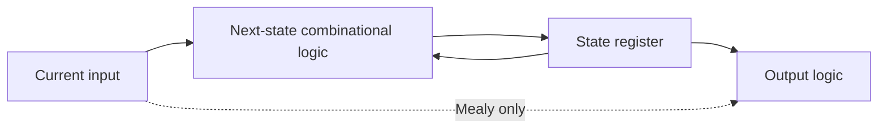
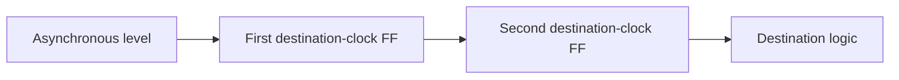
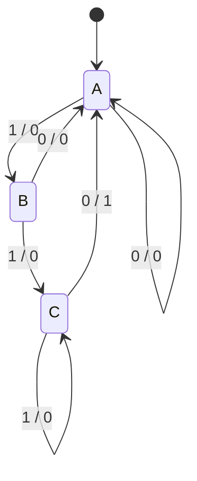

@@NOTE
Propagation Delay and Logic Hazards|传播延迟与逻辑冒险|Logic timing and glitches|timing|Ch6
> [!SUMMARY] Quick recall · 英文速览
> Propagation delay bounds the latest output settling time; contamination delay bounds the earliest possible change. Unequal path delays can produce glitches even when the steady-state Boolean expression is correct.

## Core Definition · 核心定义

传播延迟 (propagation delay) $t_{pd}$ 是从输入改变到输出保证稳定的最大延迟；污染延迟 (contamination delay) $t_{cd}$ 是输出最早可能开始改变的最小延迟。门的 rise/fall、不同输入路径与负载可有不同值，具体数值由题目或器件条件定义。

对无环网络，候选路径延迟是各门/连线延迟之和；取能够影响所需输出的最长路径为 $t_{pd}$，最短路径为 $t_{cd}$。功能敏化 (sensitization) 决定一个路径是否真正能传递变化。

## Worked Example 1 · 长短路径

假设输入 A 经过 AND–AND–OR，输入 D 只经过 OR；AND 的 $(t_{pd},t_{cd})=(30,10)$ ps，OR 为 (20,8) ps。长路径=80 ps，短路径=8 ps。前提是对应路径可敏化；不应把所有并行门的延迟直接累加。

The latest bound describes when the output is safe to sample after all relevant inputs have changed. The earliest bound matters when old data must remain stable, particularly for hold-time analysis. “The circuit delay” is incomplete unless it identifies which bound is needed.

## Derivation · Static-1 hazard

设 $F=AB+\bar AC$，B=C=1，A 由 1 变 0。稳态前后 F 都为 1，但 AB 路径可能先降到 0，NOT A 路径后升到 1，暂时两个乘积都为 0。

$$F_{safe}=AB+\bar AC+BC.$$

新增 consensus term $BC$ 不改真值表，却在这次转换过程中一直为 1。验证冗余：$BC=ABC+\bar ABC$，分别已被 AB 与 $\bar AC$ 覆盖。

| Hazard | Required steady value | Possible transient |
|---|---|---|
| Static-1 | 1 | Brief 0 |
| Static-0 | 0 | Brief 1 |
| Dynamic | Changes once | Multiple toggles |

## Worked Example 2 · 冒险宽度

初始 A=1、B=C=1。假设 AB 从 A 到输出项需要 2 ns，$\bar AC$ 需要 5 ns。A 下降后在 2–5 ns 内两项都为 0，因此可能出现约 3 ns 的低脉冲；末级门的惯性延迟与 rise/fall 特性可能缩短或过滤它。这是规定路径模型下的估计，不是通用脉宽公式。

Adding BC covers this single-input transition. It does not guarantee immunity to arbitrary simultaneous changes of several inputs. A K-map hazard check asks whether adjacent ON cells are covered by a common implicant, under the single-input-change assumption.

## Sampling and Applications · 采样与应用

同步系统若在数据稳定后采样，可容忍某些组合毛刺；但用毛刺信号驱动 clock、异步 reset 或外部控制仍可出问题。[[Setup and Hold Timing]] 约束采样时间，不能把“有时钟”直接当作无毛刺保证。

**Counter decoding.** 即使 [[Counters]] 的所有触发器使用同一 clock，clock-to-Q 不同仍可让组合 decode 短暂经过错误输出。可注册 decode，或按明确时序屏蔽转换窗口。

## Method and Exam English · 方法与英文

1. List paths to the requested output; include inversions.
2. Sum maximum and minimum delays separately.
3. State side-input values that make a path observable.
4. Compare steady-state truth with the actual transition sequence.
5. Evaluate whether the receiving element could capture the glitch.

**Exam answer:** “The Boolean output remains HIGH before and after the transition. Unequal delays temporarily remove both product terms, creating a static-1 hazard. The consensus term bridges the transition without changing the steady-state function.”

## Connections · 相关笔记

[[Combinational Circuit]], [[Karnaugh Map]], [[Universal Gates and Bubble Pushing]], [[Digital Waveforms]], [[Setup and Hold Timing]].
@@NOTE
Sequential Logic|时序逻辑|Synchronous sequential circuits|sequential-logic|Ch7
> [!SUMMARY] Quick recall · 英文速览
> State stores the relevant past. A synchronous sequential circuit computes next state with combinational logic and loads it into registers at an active clock edge.

## Core Definition · 核心定义

状态 (state) 是预测未来行为所需的历史信息，不一定包含全部过去输入。设当前状态 $Q[k]$、本周期输入 $X[k]$：

$$Q[k+1]=F(Q[k],X[k]).$$

Moore 输出 $Y[k]=G(Q[k])$；Mealy 输出 $Y[k]=G(Q[k],X[k])$。k 是 clock-cycle index，没有物理单位；实际 clock period T 有时间单位。

## Mechanism and Composition · 机制与构成

寄存器提供边界，使组合反馈路径每经过一圈至少跨过一个状态元件。同步教学模型要求所有寄存器用同一 clock，至少有一个寄存器，组合部分无回路。组合输出在周期中可变化，寄存器状态只在指定事件更新。

The arrows describe information flow. The feedback is broken in time by the register. An unclocked inverter loop can oscillate, and a bistable loop can store a bit; neither is automatically a reliable synchronous FSM.

## Worked Examples · 例题

**Running parity.** 状态 Q 记录已接收 bit 的 odd/even parity，初值 0；$Q^+=Q\oplus X$。输入 1,0,1,1 后状态 1,1,0,1。只需记忆一个 bit，因为完整历史对未来 parity 不再必要。

**Counter.** n-bit counter 的当前状态为整数 q，enabled 时 $q^+=(q+1)\bmod2^n$。当前 3 与当前 7 即使输入相同，下一个状态也不同，所以输出不能只由当前输入确定。

**Simultaneous update.** 两个 DFF 有 $D_A=Q_B,D_B=Q_A$，初值 (QA,QB)=(1,0)。下一 edge 后 (0,1)，再后 (1,0)。两个右侧都必须从同一旧状态取值；先更新 QA 再用于 QB 会错误地得到 (0,0)。

## Assumptions and Limits · 条件与边界

The recurrence is a functional model. Setup/hold must still be satisfied, asynchronous inputs must be handled, and reset must establish a specified starting state. Real outputs settle after clock-to-Q delay, not at exactly zero time.

不要把“不符合组合构成规则”的一切网络都称为“正常时序电路”。多驱动冲突可能是无定义连接；奇数反相回路可振荡；需逐类分析，不能套一个确定的 next-state table。

## Method and Review · 方法与复习

- Identify the state variables and initial values.
- Write input equations for every storage element.
- Substitute the characteristic equation to obtain next state.
- 从同一当前状态求全部 $Q^+$，随后统一更新。
- Check the active edge, asynchronous controls, and output type separately.

**Exam question:** Why is a sequence detector sequential when a four-bit pattern detector is combinational?

**Answer:** A serial detector receives one symbol at a time and must remember earlier symbols. A four-bit detector receives the entire relevant pattern simultaneously, so its output can be computed from current inputs alone.

## Connections · 相关笔记

[[Combinational Circuit]], [[Set-Reset Latch]], [[D Latch and D Flip-Flop]], [[Finite State Machine]], [[Counters]], [[Shift Registers]].
@@NOTE
Set-Reset Latch|置位复位锁存器|SR latch|sequential-logic|Ch7
> [!SUMMARY] Quick recall · 英文速览
> An SR latch stores one bit using cross-coupled feedback. The NOR version has active-high S/R; the NAND version has active-low controls. Their hold and invalid input patterns differ.

## Core Definition · 核心定义

锁存器 (latch) 利用双稳态 (bistability) 保存一位 Q。对交叉 NOR、S 和 R 高有效：$Q=\overline{R+\bar Q}$，$\bar Q=\overline{S+Q}$。这里 $\bar Q$ 是互补输出标签；禁态时它并不保证等于 NOT Q。

| S | R | Action | Q next |
|---|---|---|---|
| 0 | 0 | Hold | Previous Q |
| 1 | 0 | Set | 1 |
| 0 | 1 | Reset | 0 |
| 1 | 1 | Invalid | Both outputs forced 0 while asserted |

## Derivation · 为什么能保持

S=R=0 时，Q 与另一个输出互相取反，(Q,other)=(0,1) 与 (1,0) 都自洽。输入不指定新的状态，反馈保持已有状态。S=1 强迫另一输出为 0，随后 Q=1；R=1 对称地强迫 Q=0。

The invalid input is not merely a harmless unused truth-table row. Both NOR outputs are LOW, and when both controls are released together, delay imbalance may determine the final state. It can become unpredictable or temporarily metastable.

在排除 S=R=1 的合法域内，特征式为：

$$Q^+=S+\bar RQ.$$

不能用此式给禁态制造“优先级”。原 NOR latch 的禁态行为由电路决定，不等于具有 set priority 的新设计。

## NAND Variant · NAND 型

交叉 NAND 的输入为低有效 $\bar S,\bar R$：11 保持，01 置位，10 复位，00 禁态且两个输出都 HIGH。记忆规则“都不有效时保持，两个都有效时禁态”比死记 00/11 更稳。

| NOR active-high | NAND active-low | Meaning |
|---|---|---|
| S=0,R=0 | $\bar S=1,\bar R=1$ | Hold |
| S=1,R=0 | $\bar S=0,\bar R=1$ | Set |
| S=0,R=1 | $\bar S=1,\bar R=0$ | Reset |
| S=1,R=1 | $\bar S=0,\bar R=0$ | Invalid |

## Worked Example · 事件序列

NOR 型初值 Q=0，依次 (S,R)=10、00、01、00，状态依次 1、1、0、0。NAND 型等价输入依次 01、11、10、11，得到相同状态序列。

If a waveform enters the invalid input condition, mark it explicitly. Do not continue the trace by choosing a convenient remembered value unless the question gives a release priority or delay assumption.

## Method and Review · 方法与复习

1. Identify NOR versus NAND and input bubbles.
2. Translate voltage levels into asserted/unasserted controls.
3. Segment the waveform at every S or R transition.
4. Apply set/reset/hold and preserve the initial state.
5. Label invalid assertion and uncertain release behavior.

**Exam question:** Is Q=0 necessarily an invalid state?

**Answer:** No. Q=0 is the valid reset state when the complementary output is 1. Invalidity concerns the control combination and loss of complementary outputs, not the stored value zero.

## Connections · 相关笔记

[[NOR Gate]], [[NAND Gate]], [[Sequential Logic]], [[D Latch and D Flip-Flop]], [[Metastability and Clock Domain Crossing]].
@@NOTE
D Latch and D Flip-Flop|D锁存器与D触发器|D storage elements|sequential-logic|Ch7
> [!SUMMARY] Quick recall · 英文速览
> A D latch is level-sensitive and transparent during its enabled level. A D flip-flop is edge-triggered and captures one value at the active clock edge. They have different timing behavior despite sharing a data input.

## Core Definition · 核心定义

高电平透明 D latch 用 E 使能：E=1 时 Q 跟随 D，E=0 时保持。对合法二值稳态模型：

$$Q^+=ED+\bar EQ.$$

正沿 DFF 则在 rising edge 上 $Q^+=D$，边沿之间保持。三角形 clock 符号表示边沿触发；若三角形前有气泡，通常表示 falling edge。

## Derivation · 消除 SR 禁态

由 [[Set-Reset Latch]] 的高有效 SR 型，取 $S=ED,R=E\bar D$。E=0 时 S=R=0 保持；E=1 时只有一个控制有效，因此不会产生 S=R=1。

Two D latches controlled on opposite clock levels form an idealized master-slave DFF. At CLK=0, the master tracks D while the slave holds. When CLK rises, the master closes and the slave opens, transferring the captured master value to Q. Practical implementation must avoid uncontrolled overlap of transparency windows.

## Comparison · 对比

| Feature | D latch | Positive-edge DFF |
|---|---|---|
| Sensitive event | Entire enabled level | LOW→HIGH edge |
| Q can follow D mid-HIGH | Yes | No |
| Storage while inactive | Holds | Holds between edges |
| Basic HDL pattern | Incomplete level conditional | `rising_edge(clk)` |

## Worked Examples · 波形例题

**Example 1.** CLK 0→1 时 D=0；CLK 保持 1 时 D 变 1；CLK 1→0 时 D 仍 1。D latch：先 0，再跟随为 1，下降后保持 1。正沿 DFF：正沿采 0，中途保持 0；要等下一个正沿才可能采 1。

**Example 2.** 有效正沿前 D 依次为 1,0,1,1，DFF 初值 0；边沿后 Q 为 1,0,1,1。每次值只在 clock-to-Q 延迟后出现在物理输出，不是刚改变 D 就输出。

**Example 3.** DFF 的 D 接 NOT Q。每个正沿 $Q^+=\bar Q$，输出每两次 clock 才完成一个周期，所以 $f_Q=f_{clk}/2$。该连接实现无使能的 toggle function。

## Assumptions and Pitfalls · 条件与误区

The input must satisfy setup and hold around the capture event. For a latch, the closing event is important; while open, propagation from D to Q is also relevant. A transparent latch cannot be treated as an edge-triggered register by merely drawing its output changes at edges.

- Rising-edge triggering is a symbol/HDL property, not a universal property of every FF.
- 没有 reset 时，实际初态未必已知；例题初态须声明。
- “Sequential statements” in VHDL does not automatically mean sequential hardware.

## Exam English · 英文答题

**Question:** Why does Q remain unchanged when D changes while CLK is HIGH in a positive-edge DFF?

**Answer:** The flip-flop samples only on the LOW-to-HIGH clock transition. A later data change is outside that capture event, so the stored state remains unchanged until the next active edge, provided no asynchronous control is asserted.

## Connections · 相关笔记

[[Digital Waveforms]], [[Register Enable and Reset]], [[JK and T Flip-Flops]], [[Setup and Hold Timing]], [[VHDL Language and Modeling]], [[Shift Registers]].
@@NOTE
JK and T Flip-Flops|JK与T触发器|JK excitation table|sequential-logic|Ch7
> [!SUMMARY] Quick recall · 英文速览
> JK describes hold, reset, set, and toggle. T describes hold or toggle. Characteristic tables predict next state; excitation tables find inputs that cause a required transition.

## Core Definition and Derivation · 定义与推导

在有效边沿，JK 特征式：

$$Q^+=J\bar Q+\bar KQ.$$

若 Q=0，$Q^+=J$；若 Q=1，$Q^+=\bar K$。直接由当前状态分组得到特征式，比背诵全表更容易验证。

| J | K | Action |
|---|---|---|
| 0 | 0 | Hold |
| 0 | 1 | Reset |
| 1 | 0 | Set |
| 1 | 1 | Toggle |

TFF 用 $J=K=T$，得到 $Q^+=Q\oplus T$。T=0 保持，T=1 翻转；也可用 DFF 与 XOR 实现 $D=Q\oplus T$。

## Excitation Table · 激励表

| Q | $Q^+$ | J | K | T | D |
|---|---|---|---|---|---|
| 0 | 0 | 0 | X | 0 | 0 |
| 0 | 1 | 1 | X | 1 | 1 |
| 1 | 0 | X | 1 | 1 | 0 |
| 1 | 1 | X | 0 | 0 | 1 |

X means either binary value achieves the required transition. These excitation don't-cares are justified by the current Q value. They differ from declaring an unused state globally irrelevant.

## Conversion · 元件转换

- JK using DFF: connect $D=J\bar Q+\bar KQ$.
- DFF using JK: $J=D,K=\bar D$.
- TFF using JK: $J=K=T$.
- 无使能 toggle 用 DFF：$D=\bar Q$。

使用 2:1 MUX 也能实现 JK 的 D 式：select Q，D0=J，D1=NOT K。Q=0 选 J；Q=1 选 NOT K。这里 MUX 的 select 是**当前输出 Q**，不是 clock。

## Worked Examples · 例题

**Trace.** Q 初值 0，连续有效边沿的 JK 输入为 10、11、00、01，Q 变为 1、0、0、0。最后 reset 没有产生边沿以外的动作，因为这是同步 JK 输入。

**Design one bit.** 状态要求 0→1、1→0，激励表给 0 时 J=1，1 时 K=1；选择 J=K=1 可满足两种转换。输出以输入 clock 一半频率翻转。

**Race-around boundary.** Level-sensitive JK feedback with J=K=1 can toggle repeatedly during a long enabled pulse. An edge-triggered or suitable master-slave implementation limits updating to the intended event. Do not apply the edge table blindly to a transparent feedback latch.

## Method and Review · 方法与复习

分析题：先求 J,K，再代 characteristic equation 求全部 next states。设计题：先给 desired transitions，再查 excitation table 求 J,K，最后化简。

**Exam question:** Why is K a don't-care for the transition 0→1?

**Answer:** With Q=0, the term $\bar KQ$ is zero regardless of K. The next state therefore depends only on J, and J must be 1.

## Connections · 相关笔记

[[D Latch and D Flip-Flop]], [[Multiplexer and Demultiplexer]], [[Synchronous Counter Design]], [[Karnaugh Map with Don't Cares]], [[Sequential Logic]].
@@NOTE
Register Enable and Reset|寄存器使能与复位|Enabled and resettable registers|sequential-logic|Ch7
> [!SUMMARY] Quick recall · 英文速览
> Enable chooses load or hold at the clock edge. Synchronous reset acts at an edge; asynchronous reset can act between edges. Priority among reset, load, enable, and hold must be specified.

## Core Definition · 核心定义

寄存器 (register) 由多位状态元件组成，通常共享 clock。对每一位，高有效 EN 的 enabled DFF：

$$Q^+=EN\cdot D+\overline{EN}\cdot Q.$$

EN=0 的保持用输出反馈到输入的 MUX 实现。不是把 clock 用普通 AND 随意截断；clock gating 的可靠实现需要专门时序约束。

## Reset and Set · 复位与置位

高有效 synchronous reset R：只在有效边沿执行，$Q^+=0$ if R=1，否则正常 load/hold。高有效 asynchronous reset：R=1 时不用等 clock 就把 Q 强制为 0。set/preset 对称地强制为 1。

If reset has priority over enable, the next-state rule is:

$$Q^+=\begin{cases}0,&R=1\\D,&R=0,EN=1\\Q,&R=0,EN=0.\end{cases}$$

This recurrence describes edge behavior for synchronous reset. For asynchronous reset, add the between-edge reset action to the waveform model; an edge-only table is not the whole behavior.

## Worked Examples · 例题

**Example 1.** 四位 Q 初值 1010，边沿时 EN=0,D=0011，Q 保持 1010；下次 EN=1，Q 变 0011；再下次 R=1,EN=1，reset priority 使 Q=0000。

**Example 2.** 在两个正沿之间 R 从 0 到 1：异步复位输出随 reset 延迟变 0；同步复位仍保持旧值，直到下一个正沿。两种设计的 HDL sensitivity list 与 if 条件位置不同。

**Example 3.** 高有效 synchronous set：$D_{effective}=S+D$，因为 S=1 时输入固定 1，S=0 时保留 D。仅在 capture edge 生效；这不等同于修改内部 FF 的 asynchronous preset pin。

## Timing Boundary · 时序边界

Reset assertion and release have different concerns. An asynchronous assertion can establish a state without the clock, but release near a clock edge may violate recovery/removal constraints. A synchronously released reset is often used to make restart consistent; this is an implementation practice, not a proof that every reset circuit is safe.

EN 与同步控制也是待采样的数据路径，需要满足 setup/hold。若同时要求 LOAD、EN、CLR，按 function table 的 priority 写分段式，再作波形；不能自行选择顺序。

## Method and Exam English · 方法与答题

1. List control polarity and synchronous/asynchronous behavior.
2. Write the priority from highest to lowest.
3. Record control values just before each edge.
4. Apply asynchronous events immediately when asserted.
5. Confirm that “hold” retains every bit, rather than loading zero.

**Question:** Does EN=0 force Q=0?

**Answer:** No. Enable LOW normally inhibits loading and retains the previous value. Reset is a separate control with its own polarity, timing, and priority.

## Connections · 相关笔记

[[D Latch and D Flip-Flop]], [[Multiplexer and Demultiplexer]], [[Shift Registers]], [[Counters]], [[Setup and Hold Timing]], [[VHDL Language and Modeling]].
@@NOTE
Setup and Hold Timing|建立与保持时间|Register timing constraints|timing|Ch9
> [!SUMMARY] Quick recall · 英文速览
> Setup constrains the latest arrival before the next capture edge. Hold constrains the earliest arrival after the current capture edge. Lowering frequency can repair a setup violation but does not normally repair a hold violation.

## Definitions and Assumptions · 定义与假设

- $t_{setup}$：捕获边沿前数据需稳定的时间。
- $t_{hold}$：捕获边沿后数据需继续稳定的时间。
- $t_{pcq}$：launch FF 的最大 clock-to-Q delay。
- $t_{ccq}$：launch FF 的最小 clock-to-Q delay。
- $t_{pd},t_{cd}$：中间组合逻辑的最大/最小延迟。
- $T$：clock period，所有时间使用相同单位。

The baseline model uses the same clock, zero skew, and no extra uncertainty. “Maximum frequency” is meaningful only after both setup and hold have passed.

## Setup Derivation · 建立约束推导

在 t=0 launch，最晚新数据到达时间 $t_{pcq}+t_{pd}$；下次 capture 在 T，需提前 $t_{setup}$ 稳定：

$$t_{pcq}+t_{pd}\le T-t_{setup},\quad T\ge t_{pcq}+t_{pd}+t_{setup}.$$

$$f_{max}=\frac1{t_{pcq}+t_{pd}+t_{setup}}.$$

此式是在该模型并满足 hold 后的上界。多条路径取最严格者。

## Hold Derivation · 保持约束推导

同一个 t=0 capture 之后，还需保留旧值 $t_{hold}$；新数据最早到达 $t_{ccq}+t_{cd}$：

$$t_{ccq}+t_{cd}\ge t_{hold}.$$

Hold is a same-edge check. T does not appear because the risk concerns the current capture edge, not the next one. Add delay on the short path, change the cell/path, or adjust the clock relationship as appropriate.

## Worked Example · 同时检查两条约束

给 $t_{ccq}=30$ ps、$t_{pcq}=50$ ps、setup=60 ps、hold=70 ps；长路径为三个门，每门 $t_{pd}=35$ ps；短路径一个门，$t_{cd}=25$ ps。

$$T_{min}=50+3(35)+60=215\text{ ps},\quad f=4.651\text{ GHz}.$$

但是 hold：$30+25=55<70$ ps，失败。不能宣布“以 4 GHz 就能运行”；即使降到 1 MHz，当前边沿附近仍有相同问题。

短路径增加一个 minimum delay=25 ps 的 buffer 后，hold 到达时间为 80 ps，slack=10 ps。仍要重新检查最长路径，确认该 buffer 是否也影响 setup；不可以默认修复没有代价。

## Skew Extension · 偏斜扩展

定义 capture clock 比 launch **晚** $s$：同一对应边沿在 capture 端时刻 s。忽略 jitter 时：

$$T\ge t_{pcq}+t_{pd}+t_{setup}-s,$$
$$t_{ccq}+t_{cd}\ge t_{hold}+s.$$

Positive capture skew helps setup but hurts hold. Never memorize a skew sign without defining which clock arrives later. Extra uncertainty reduces available margin; its application depends on the timing model supplied.

## Method and Review · 方法与复习

1. Separate maximum and minimum path calculations.
2. Define the launch and capture edges.
3. Compute setup slack and hold slack independently.
4. State the repair and rerun both constraints.

**Exam answer:** “The setup bound permits a 215 ps period, but the 15 ps hold violation prevents reliable operation at any period under the stated zero-skew model. A short-path delay element can repair hold if the revised setup bound still passes.”

## Connections · 相关笔记

[[Propagation Delay and Logic Hazards]], [[D Latch and D Flip-Flop]], [[Sequential Logic]], [[Metastability and Clock Domain Crossing]], [[Field-Programmable Gate Array]].
@@NOTE
Metastability and Clock Domain Crossing|亚稳态与时钟域跨越|CDC and synchronizers|timing|Ch9
> [!SUMMARY] Quick recall · 英文速览
> Sampling an asynchronous transition can violate setup/hold and leave a flip-flop temporarily metastable. A synchronizer reduces the chance that this uncertainty reaches downstream logic; it cannot promise zero risk.

## Core Definition · 核心定义

亚稳态 (metastability) 是存储元件暂时未解析成可靠 0/1 的物理状态。异步按钮、其他 clock domain 的信号或 reset release 都可能在 aperture 附近变化；不能因为仿真只显示 0/1 就认为实物没有风险。

## Mechanism · 两级同步器

第一级采异步输入；第二级在下一个目标 clock 边沿采第一级，让第一级获得接近一个周期的解析时间。下游只能使用第二级输出。

This block diagram shows a single-bit level synchronizer. Place the stages close and avoid combinational logic between them when applying this pattern. Exact reliability depends on clock/data rates, device parameters, and available resolution time; no universal MTBF number follows from “two stages”.

## Validity Boundaries · 适用边界

- 单位 level：若保持足够久，可让目标域采到稳定值。
- Narrow pulse：可能整个脉冲落在采样边沿之间，完全漏掉。
- Multi-bit word：逐位同步可能采出混合新旧值，不能保证 atomicity。
- Mechanical button：同步减少亚稳传播，debounce 处理多次接触跳变，是不同问题。

For event transfer, use a specified pulse-stretching, toggle, or handshake scheme. For multi-bit data, use a stable-data handshake or an asynchronous FIFO as appropriate. These are extensions beyond the basic one-bit classroom circuit.

## Worked Examples · 例题

**Pulse loss.** 目标周期 T=10 ns，输入脉冲在 2–5 ns 为 HIGH，采样边沿在 0、10、20 ns。即使脉冲很干净，所有采样看到 LOW，事件漏掉。两级同步器不能恢复一个从未采到的 pulse。

**Mixed binary count.** 异步读取 0111→1000 的四位，路径不同可混成 0000 或 1111。[[Gray Code]] 每次合法相邻变化只改一位，减少混合码问题，但仍要同步和保证采样/传输约束，不能直接当作万能 CDC 方案。

**Button.** 50 MHz clock 下，机械抖动 2 ms 相当于 100,000 周期。两级 FF 只提供几十 ns 的同步过程，不会自动消除 2 ms 的多次翻转。计数稳定时间的 debounce logic 才处理这个规格。

## Method and Exam English · 方法与答题

Identify source and destination clocks, classify level versus pulse versus word, then choose an interface that preserves the information. A synchronizer is an interface design, not merely an extra flip-flop placed anywhere.

**Question:** Does reducing the clock frequency make an asynchronous input obey setup and hold?

**Answer:** It may provide more resolution time, but the input can still change arbitrarily close to a capture edge. The asynchronous relationship remains and must be handled explicitly.

## Connections · 相关笔记

[[Setup and Hold Timing]], [[Register Enable and Reset]], [[Gray Code]], [[Digital Abstraction and System Design]], [[One-Shots and Pulse Applications]], [[Testbench and Functional Verification]].
@@NOTE
Shift Registers|移位寄存器|SISO SIPO PISO PIPO|registers|Ch8
> [!SUMMARY] Quick recall · 英文速览
> A shift register stores a word and moves each bit to a neighboring stage at the clock edge. Every stage uses the old state. Serial order, displayed bit order, and physical drawing direction must be stated explicitly.

## Core Definition · 核心定义

定义 4-bit 状态向量 $Q_3Q_2Q_1Q_0$，Q3 为 MSB。本篇 right shift 指向低位：

$$Q^+=\{SR,Q_3,Q_2,Q_1\}.$$

left shift 指向高位：$Q^+=\{Q_2,Q_1,Q_0,SL\}$。SR/SL 是对应边界的 serial input。讲义电路若把 Q0 画在左侧，“向图右移”可能对应位编号增加；必须先写节点更新式，不能从词语猜数值右移。

| Type | Entry | Observation | Typical use |
|---|---|---|---|
| SISO | One bit per edge | Last stage | Sample delay |
| SIPO | Serial | Whole word | Receive/expand inputs |
| PISO | Parallel load | Serial | Transmit/serialize |
| PIPO | Parallel | Parallel | Store a word |

PIPO 本身可只是并行寄存器；“parallel” 不自动表示每个周期也会 shift。

## Derivation · Universal register

本篇 mode=$S_1S_0$：00 hold、01 right、10 left、11 parallel load。每个 D 输入前的 MUX 选择旧自身、相邻旧位、另侧旧位或并行输入。reset 若有则明确优先级。

All flip-flops share the clock. Their outputs change together logically, after physical clock-to-Q delays. Updating the stages one at a time with new values would incorrectly propagate a bit through the whole register in one edge.

## Worked Example 1 · 左右混合

初态 Q=1011，SR=0，SL=1：

| Edge | Mode | New $Q_3Q_2Q_1Q_0$ |
|---|---|---|
| 0 | Initial | 1011 |
| 1 | Right | 0101 |
| 2 | Right | 0010 |
| 3 | Left | 0101 |
| 4 | Hold | 0101 |
| 5 | Load 1100 | 1100 |

检查 right step：1011 无符号是 11，右移补 0 得 floor(11/2)=5。left shift 有限位宽会丢掉 MSB，不能总当作精确乘 2。

## Worked Example 2 · 串入和时延

初值 0000，right shift serial input 按时间为 1,0,1,1，状态为 1000、0100、1010、1101。最早输入的 bit 最终到 Q0，所以按 Q3…Q0 阅读得到输入时间顺序的反向。

An n-stage pipeline whose recurrence is $Q_0[k+1]=X[k]$, $Q_i[k+1]=Q_{i-1}[k]$ gives $Q_{n-1}[k+n]=X[k]$. From the first capture edge to the last-stage capture edge there are n−1 edge intervals. Calling its discrete input-to-output delay n cycles uses the stated pre-edge input indexing; define the timing reference to avoid an off-by-one claim.

## Applications and Review · 应用与复习

PISO load 1011，若每次先观察 Q0 再 right shift，则发送 1,1,0,1（LSB first）。若输出取 Q3 并 left shift，则可以 MSB first；两种都能工作，但协议必须一致。

For a serial link, wire count is reduced at the cost of several bit intervals per word. A UART adds framing and sampling rules; a bare shift register alone is not a complete UART.

**Exam answer:** “I define the stored word as Q3Q2Q1Q0. At each active edge I compute all four new bits from the pre-edge state and the sampled direction input, then update the entire word.”

## Connections · 相关笔记

[[D Latch and D Flip-Flop]], [[Multiplexer and Demultiplexer]], [[Register Enable and Reset]], [[Ring and Johnson Counters]], [[Cyclic Redundancy Check]], [[Structural Shift Register Project]].
@@NOTE
Ring and Johnson Counters|环形与约翰逊计数器|Shift register counters|registers|Ch8
> [!SUMMARY] Quick recall · 英文速览
> A ring counter feeds the last bit back unchanged; a Johnson counter feeds it back inverted. An n-stage one-hot ring has n states; an initialized Johnson cycle has 2n states. Initialization is part of the design.

## Core Definition and Model · 定义与模型

按 $Q_3Q_2Q_1Q_0$ 排列、right shift：ring 用 $Q^+=\{Q_0,Q_3,Q_2,Q_1\}$；Johnson 用 $Q^+=\{\bar Q_0,Q_3,Q_2,Q_1\}$。两者都用 FF 保存状态，与 [[Counters]] 的 binary increment 结构不同。

## Ring Derivation · 环形序列

one-hot seed 1000 旋转：1000→0100→0010→0001→1000，n=4 得 modulus 4。一周期内每个输出 HIGH 一拍，因此输出重复频率 $f_{clk}/4$、占空比 25%。

All-zero ring state stays all zero. A ring with two initial ones does not become one-hot by itself. Modulus n refers to the intended seeded cycle, not every possible state of the hardware.

one-cold seed 1110 也可扫描低有效按键线路：1110→0111→1011→1101→1110。这是有效极性改变，仍只有一个扫描位置 active。

## Johnson Derivation · 扭环序列

从 0000 开始：

| Step | State |
|---|---|
| 0 | 0000 |
| 1 | 1000 |
| 2 | 1100 |
| 3 | 1110 |
| 4 | 1111 |
| 5 | 0111 |
| 6 | 0011 |
| 7 | 0001 |
| 8 | 0000 |

先连续填入 n 个 1，再连续填入 n 个 0，共 2n 个状态。它不是 n-bit binary counter 的 $2^n$ 个状态；n=4 时是 8 而不是 16。

## Worked Examples · 例题

**Frequency.** 5-stage Johnson，input clock=1 MHz，完整序列重复=100 kHz；各 Q 位在合法周期中 HIGH 5 拍、LOW 5 拍，50% duty。one-hot 5-stage ring 的各位 duty=20%。

**Illegal cycle.** 四位 Johnson 从 0101 出发，按上述 recurrence 得到 0101→0010→1001→0100→1010→1101→0110→1011→0101，共 8 态，且与预期的 0000 cycle 分离。不要因为“Johnson modulus 8”就认为所有状态都落入 intended 0000 cycle。reset 可建立预期起点。

**Keyboard scan.** n=8、scan edge rate=5 kHz，完整扫描周期 $8/5000=1.6$ ms。同一个 row 每 1.6 ms 被访问一次。整个扫描频率是 625 Hz，不是每行都 5 kHz。

## Method and Review · 方法与复习

Write the exact feedback bit and inversion, declare the initial state, then enumerate until the first repeat. The modulus is the length of that cycle. A state decoding expression is valid only for the state domain used to derive it.

**Question:** Why must a one-hot ring be seeded with one 1?

**Answer:** Feedback preserves the number of ones. Starting at all zeros cannot create an active stage, so the intended rotating-one sequence never starts.

## Connections · 相关笔记

[[Shift Registers]], [[Register Enable and Reset]], [[Encoder and Priority Encoder]], [[Counters]], [[State Encoding and Unused States]].
@@NOTE
One-Shots and Pulse Applications|单稳态与脉冲应用|Monostable and astable circuits|registers|Ch8
> [!SUMMARY] Quick recall · 英文速览
> A monostable one-shot has one stable state and emits a timed pulse after a trigger. An astable oscillator has no stable state and repeats. A bistable element stores one of two stable states.

## Core Definition · 核心定义

单稳态 (monostable) 接受一次 trigger 后进入暂态，再回到稳定状态；脉冲宽度由时间机制决定。无稳态 (astable) 自动周期变化；双稳态 (bistable) 如 SR latch 可存储一位。

| Circuit | Stable states | Trigger behavior | Use |
|---|---|---|---|
| Bistable | 2 | Changes/holds state | Memory |
| Monostable | 1 | Produces one pulse | Pulse shaping/delay |
| Astable | 0 | Repeats autonomously | Oscillation |

Retriggerable one-shots can restart or extend their interval on a new trigger. Nonretriggerable ones ignore triggers during the active interval under their specified operating conditions. Read the device's rule before drawing pulses.

## Derivation · RC timing boundary

RC 充电的理想式：

$$V_C(t)=V_\infty+(V_0-V_\infty)e^{-t/(RC)}.$$

若在 $V_{th}$ 终止脉冲：

$$t_p=-RC\ln\frac{V_\infty-V_{th}}{V_\infty-V_0}.$$

R 为 Ω，C 为 F，RC 为 s。比例系数取决于阈值、初值与拓扑；不能对所有 one-shot 都写 $t_p=RC$ 或照用某个 IC 的系数。

## Worked Examples · 例题

**Ideal threshold.** $V_0=0,V_\infty=5$ V、$V_{th}=2.5$ V、R=10 kΩ、C=100 nF，RC=1 ms，$t_p=0.693$ ms。阈值改为 $2V_\infty/3$ 时系数为 $\ln3\approx1.099$，可见阈值决定时长。

**Digital pulse.** 要在 1 MHz clock 域生成 10 μs pulse，可在 trigger 被接受后计数 10 个完整周期。输出进入 active 时刻与停止边沿要定义清楚；若计数 0–9，则 ten states 对应十拍。

**Debounce.** 假定开关在 2 ms 内反复跳变，nonretriggerable 脉冲宽度取 3 ms 可屏蔽这次假定范围内的额外 trigger，但不能凭该数值保证任意开关都不抖动。也可要求输入持续稳定指定拍数再接受。

## Edge Detection · 边沿检测

同步后的 level X，令延迟状态 $X_d^+=X$，组合 pulse $P=X\bar X_d$，在 X 第一次变 HIGH 的周期出现脉冲。异步输入须先同步，否则组合 edge detector 可能传播不受控短脉冲。

A delayed gate path can create a narrow transition spike in a teaching circuit. Its width depends on physical delay and operating conditions, so it should not be treated as a robust general clock source. Use a specified clock and synchronous enable when building ordinary FPGA logic.

## Exam English and Connections · 答题与关联

**Question:** Is a one-shot an astable multivibrator?

**Answer:** No. A one-shot is monostable and produces one timed output pulse per accepted trigger. An astable circuit oscillates without returning permanently to a stable state.

[[Digital Waveforms]], [[Set-Reset Latch]], [[Metastability and Clock Domain Crossing]], [[Shift Registers]], [[Cascaded Counters and Digital Clocks]].
@@NOTE
Finite State Machine|有限状态机|FSM|finite-state-machines|Ch9
> [!SUMMARY] Quick recall · 英文速览
> An FSM combines a state register, next-state logic, and output logic. Build a transition table from the specification before choosing encodings or deriving gates.

## Core Definition · 核心定义

有限状态机 (finite state machine) 用有限个状态概括历史。状态不只是“当前输出”，还要包含决定后续行为所需的信息。状态寄存器存 current state，组合逻辑计算 next state 与 outputs。

$$S[k+1]=F(S[k],X[k]).$$

此式适用于明确采样事件的同步 FSM。Moore/Mealy 的区别在输出函数，不在 next-state 是否依赖输入。

## Design Procedure · 设计过程

1. Identify inputs, outputs, polarity, sampling events, and reset behavior.
2. State what information must be remembered.
3. Draw a complete transition diagram.
4. Convert every arrow into transition/output tables.
5. Select an encoding and define unused-state behavior.
6. Derive storage-element inputs and output equations.
7. Verify transitions, outputs, reset, and timing.

## Worked Example · 按钮切换灯

输入 X 为已同步且每次按下只一拍的 event；状态 OFF/ON，X=1 时切换，X=0 保持；Moore 输出 Y 在 ON 时 1。编码 OFF=0、ON=1。

| Current Q | X | Next Q | Current Y |
|---|---|---|---|
| 0 | 0 | 0 | 0 |
| 0 | 1 | 1 | 0 |
| 1 | 0 | 1 | 1 |
| 1 | 1 | 0 | 1 |

$$D=Q\oplus X,\quad Y=Q.$$

从 OFF 输入 0,1,0,1，边沿后 Q 为 0,1,1,0。若 X 是持续三拍的 button level，电路会切换三次；这不是状态机方程错误，而是 event interface 没有实现需求。

## State Meaning and Completeness · 状态含义与完备性

For each state, outgoing conditions must be mutually exclusive and cover every valid input. Missing an input case is not a legitimate don't-care unless the specification explicitly excludes it. Reset identifies a starting state and should match an actual available encoding.

设计与分析方向相反。已有电路的分析先写各 FF 输入，再由 characteristic equation 得到 Q+，把得到的 table 画成图。不能先凭外形猜“这是计数器”再填表。

## Assumptions and Pitfalls · 条件与误区

- A state label such as S2 is a name, not necessarily binary 10.
- 时钟每拍更新的是编码，不是把图上的每条箭头都自动走一遍。
- 同一时钟并不保证输出完全无毛刺；实际输出 decode 仍有 delay。
- Registering a Mealy output changes its externally observed timing.

## Exam English · 英文答题

**Question:** Why choose states before Boolean equations?

**Answer:** State meanings define what history must be retained and which transitions are required. Encoding is only a representation of that behavior. Deriving gates before fixing the behavior can produce a compact circuit that implements the wrong machine.

## Connections · 相关笔记

[[Sequential Logic]], [[Moore and Mealy Machines]], [[State Encoding and Unused States]], [[Sequence Detector]], [[Traffic Light Controller]], [[Synchronous Counter Design]], [[VHDL Language and Modeling]].
@@NOTE
Moore and Mealy Machines|Moore与Mealy状态机|FSM output models|finite-state-machines|Ch9
> [!SUMMARY] Quick recall · 英文速览
> Moore outputs depend on state; Mealy outputs depend on state and current input. Compare output timing using an explicit sampling convention, rather than saying one model is universally one clock faster.

## Core Definition · 核心定义

$$\text{Moore: }Y=G(S),\qquad \text{Mealy: }Y=G(S,X).$$

两者均有 $S^+=F(S,X)$。Moore 在节点中标输出；Mealy 在边上写 input/output。Mealy 可在 edge 之间响应 input，Moore 的组合 decode 也并非物理上绝对无毛刺。

## Worked Example · 检测最近两位 01

串行输入 x，每个正沿采一位，可重叠。Mealy 状态 A=尚无末尾 0，B=末尾为 0：

| State | x=0 | x=1 |
|---|---|---|
| A | B / 0 | A / 0 |
| B | B / 0 | A / 1 |

编码 B=1、A=0：$D=\bar x$，$Y=Qx$。当前 Q=1 且 x=1，就表示前位是 0、当前位是 1。

Moore 用 A=no match、B=末尾 0、C=刚检出 01；A:0→B,1→A；B:0→B,1→C；C:0→B,1→A；仅 C 的输出 1。把匹配事件编码到状态，需要此处第三个状态。

## Output Timing · 输出时间对齐

定义 x[k] 在第 k 个捕获边沿前稳定，S[k] 是该边沿前状态。Mealy 的 pre-edge 输出为 $G(S[k],x[k])$；Moore 的 post-edge 输出为 $G(S[k+1])$。两者可以对应同一个刚结束的输入位，只是有效窗口不同。

For input 0 then 1, Mealy can assert while the second bit is present before its capture edge. Moore asserts after that edge updates the machine into the detection state. Describing this as “one-cycle later” is meaningful only if the reference point is the arrival of the second input, not if both outputs are compared after the same capture edge.

Mealy 若 next state 在 edge 后立即回 A，输出会随着 Q 改变而撤销；接收者若也在该 edge 采样，可采到 edge 前的检测值，但必须满足 timing。不要画一个未经说明的固定整拍 pulse。

## Tradeoffs · 取舍

| Dimension | Moore | Mealy |
|---|---|---|
| Input in output cone | No direct input | Yes |
| State count | May be larger | Often smaller |
| Within-cycle input response | Through state update | Can respond immediately |
| Input glitch exposure | Less direct | Direct combinational path |
| Absolute glitch-free guarantee | No | No |

## Additional Example · 同一状态不同输出

一个 vending controller 当前等待付款。Mealy 输出 dispense 可依赖“当前 coin 使金额刚好达标”；Moore 则进入 DISPENSE state 后输出。该例只说明 output placement；具体零钱、输入同步和脉冲宽度应另定规范。

## Method and Review · 方法与复习

Check whether the output equation contains current input. Do not classify a diagram merely by the presence of arrows or number of states. Both state machines have input-dependent transitions.

**Exam answer:** “This is Mealy because its output is labeled on transitions and depends on current input as well as state. A Moore implementation places the detection indication in a state and changes the timing of that indication.”

## Connections · 相关笔记

[[Finite State Machine]], [[Sequence Detector]], [[Traffic Light Controller]], [[Setup and Hold Timing]], [[Testbench and Functional Verification]].
@@NOTE
State Encoding and Unused States|状态编码与未用状态|Binary and one-hot encoding|finite-state-machines|Ch9
> [!SUMMARY] Quick recall · 英文速览
> Encoding changes the hardware representation, not the intended behavior. Binary uses at least ceiling(log2 N) bits; one-hot uses N bits. Unused codes need an explicit policy.

## Core Definition and Derivation · 定义与推导

N 个状态由 b 位寄存器编码，需要 $2^b\ge N$，所以 $b=\lceil\log_2N\rceil$。one-hot 每状态一位，合法域恰好一个 1，需要 N 位。

| N | Minimum binary FFs | One-hot FFs | Unused binary codes |
|---|---|---|---|
| 3 | 2 | 3 | 1 |
| 4 | 2 | 4 | 0 |
| 5 | 3 | 5 | 3 |
| 10 | 4 | 10 | 6 |

One-hot often simplifies the logic because state membership is available directly as one bit. More flip-flops do not automatically mean slower logic. Area and delay depend on mapping, routing, and the target hardware.

## Worked Example · 三态循环

行为 A→B→C→A。binary 编码 A=00,B=01,C=10；给 unused 11→00 恢复：

| Q1Q0 | Next |
|---|---|
| 00 | 01 |
| 01 | 10 |
| 10 | 00 |
| 11 | 00 |

$$D_1=\bar Q_1Q_0,\qquad D_0=\bar Q_1\bar Q_0.$$

one-hot 向量 $(q_C,q_B,q_A)$：001→010→100→001，$q_A^+=q_C,q_B^+=q_A,q_C^+=q_B$。合法域下只有连线即可；但 000 会自锁，multi-hot 会循环，必须另加 reset/illegal-state recovery 才能满足完整规范。

## Don't-Care Policy · 无关项策略

把 11 标 X 可能进一步化简 binary next-state equations，但所得 implementation 对 11 有具体行为。必须把最终 equations 在 11 代入，确认它是 recover、lock 或另一个 cycle。

“Unused in normal operation” is not equivalent to “physically impossible.” Power-up, disturbances, reset inconsistencies, or design mistakes can produce an unused code. The course may allow don't-cares for minimization; engineering recovery requires additional behavior and verification.

对于 one-hot 有 $2^N-N$ 个非法码。定义 `others` 的 RTL 分支有助于描述意图，但综合可能按其 FSM优化/编码策略改变实现；要核对实际实现与约束，不能把一行 default 当作物理安全证明。

## Method and Review · 方法与复习

1. List semantic states before assigning bits.
2. Record the encoding next to the diagram and tables.
3. Re-derive each next-state bit under that encoding.
4. Check reset and every unused code.
5. Compare logic and FF costs using the actual implementation.

**Question:** Why can the same FSM have different equations in two answers?

**Answer:** Different state encodings assign different bit patterns to the same semantic states. The Boolean equations can differ while the externally specified transitions and outputs remain equivalent.

## Connections · 相关笔记

[[Bits and Bytes]], [[Karnaugh Map with Don't Cares]], [[Finite State Machine]], [[Ring and Johnson Counters]], [[Synchronous Counter Design]], [[Field-Programmable Gate Array]].
@@NOTE
Sequence Detector|序列检测器|Overlapping sequence detection|finite-state-machines|Ch9
> [!SUMMARY] Quick recall · 英文速览
> A serial pattern detector stores the longest relevant suffix of past input. Overlap means that the end of one match may become the beginning of the next match.

## Specification · 明确规范

本篇检测串行 110，高有效 input x，一位每正沿，Mealy 输出 z，允许重叠。状态表示已匹配的最长前缀：A=none、B=1、C=11。reset→A。

## Derivation · 最长后缀原则

- A 收 0：没有前缀可保留，留 A；收 1：到 B。
- B 收 0：10 的后缀没有前缀 1，回 A；收 1：到 C。
- C 收 1：111 的最长相关后缀仍是 11，留 C。
- C 收 0：110 匹配，输出 1；110 的后缀没有以 1 开始的可用前缀，回 A。

| State | x=0 next / z | x=1 next / z |
|---|---|---|
| A | A / 0 | B / 0 |
| B | A / 0 | C / 0 |
| C | A / 1 | C / 0 |

## Encoded Equations · 编码方程

令 A=00,B=01,C=10；规定 11 对任意 x 恢复 A 且 z=0：

$$D_1=x(Q_1\oplus Q_0),\qquad D_0=x\bar Q_1\bar Q_0,\qquad z=Q_1\bar Q_0\bar x.$$

检查 C=10,x=1 得 D=10；C,x=0 得 D=00,z=1。编码域 11 时 XOR=0、两个 D=0，z=0，符合恢复规定。输出是在 current state 与 current input 的组合窗口内有效。

## Worked Example · 追踪 1110110

| Bit number | Input | Pre-state | z | Post-state |
|---|---|---|---|---|
| 1 | 1 | A | 0 | B |
| 2 | 1 | B | 0 | C |
| 3 | 1 | C | 0 | C |
| 4 | 0 | C | 1 | A |
| 5 | 1 | A | 0 | B |
| 6 | 1 | B | 0 | C |
| 7 | 0 | C | 1 | A |

匹配结束于第 4、7 位。111 中保持 C 是为了不丢掉最近两个 1；若每次多一个 1 就 reset，会漏掉第 4 位结束的匹配。

## Overlap Example · 101 的重叠

对于 101，检测完成后最后一个 1 可以作为下一次的首位，故返回“已看到 1”的状态，而不是无匹配状态。输入 10101 有两个 match，结束于位 3、5。110 的完成后没有这样的非空可复用后缀，所以本例回 A 仍正确。

## Method and Exam English · 方法与答题

For each state and input, append the new symbol and keep the longest suffix that is also a prefix of the target pattern. This rule handles repeated symbols and overlap systematically.

- 明确 simultaneous word detection 与 serial detection，见 [[Combinational Logic Design]]。
- 标注 Mealy 输出在 edge 前窗口还是 registered post-edge pulse。
- 最少测试 exact match、near miss、重复前缀、连续匹配和 reset。

**Exam answer:** “Each state represents the longest suffix that remains useful for matching the target. On a completed match, I retain any suffix that can start another match, so overlapping occurrences are not lost.”

## Connections · 相关笔记

[[Finite State Machine]], [[Moore and Mealy Machines]], [[State Encoding and Unused States]], [[Shift Registers]], [[Testbench and Functional Verification]].
@@NOTE
Traffic Light Controller|交通灯控制器|Traffic control FSM|finite-state-machines|Ch9
> [!SUMMARY] Quick recall · 英文速览
> A traffic-light FSM separates state transitions from output encoding. Sensor polarity, timer meaning, and yellow-light duration must be specified before deriving equations.

## Specification · 规范与模型边界

这是双道路教学模型，不是道路安全控制完整规范。状态 A=A绿/B红，B=A黄/B红，C=A红/B绿，D=A红/B黄。TA/TB=1 表示相应道路有车；reset→A。

本例 A 在 TA=1 时保持、TA=0 时到 B；B 一拍后到 C；C 在 TB=1 时保持、TB=0 时到 D；D 一拍后回 A。现实 yellow duration、all-red clearance 与 fairness 需另加 timer/state。

## Transition Table · 转换表

| State | Condition | Next |
|---|---|---|
| A | TA=1 | A |
| A | TA=0 | B |
| B | Any | C |
| C | TB=1 | C |
| C | TB=0 | D |
| D | Any | A |

Use X only for an input that genuinely has no effect in that state. The B and D rows cover all four sensor combinations; they are not missing input cases.

## Derivation · 编码与输出

取 A=00,B=01,C=10,D=11，$Q_1Q_0$ 为当前编码。逐行写每一位 next=1 的情况：

$$D_1=Q_1\oplus Q_0,$$
$$D_0=\bar Q_1\bar Q_0\bar T_A+Q_1\bar Q_0\bar T_B.$$

输出灯编码 green=00,yellow=01,red=10，则：

$$L_{A1}=Q_1,\quad L_{A0}=\bar Q_1Q_0,\quad L_{B1}=\bar Q_1,\quad L_{B0}=Q_1Q_0.$$

两位 lamp code 是功能编码，不能直接等同于三个 LED 的引脚驱动。每盏实际红黄绿灯还需 decode 和相应电气接口。

## Worked Example · 状态追踪

reset 后 A。TA=1 时两拍留 A；TA=0 时下一 edge 到 B；随后到 C；TB=1 时留 C；TB=0 时到 D；再回 A。每个 output 从**当前状态**解码，因此在 A→B 的更新之后才显示 A 黄。

Check the invariant: no legal state has both roads green. The four-state model passes that check, but it can starve the other road if the active-road sensor remains TRUE forever. Add a maximum-green timer if fairness is part of the specification.

## Timer Extension · 定时器扩展

若 yellow 要 3 s、clock event 为 1 Hz，可以增加三拍黄灯状态或单独的 timer counter。进入 yellow 时清零，达到 terminal count 才允许转换。必须定义“从进入开始算三拍”的边沿约定，避免 2 s/4 s 的 off-by-one。

If a problem defines TL=1 while a long timer is running and TL=0 when expired, expiration is NOT TL. Different diagrams may use the opposite convention. Translate the wording into a predicate rather than transferring equations between differently labeled controllers.

## Method and Exam English · 方法与答题

1. Separate semantic light states from their bit encodings.
2. Write every transition condition with explicit sensor/timer polarity.
3. Derive next-state and output equations independently.
4. Verify legal outputs and simulate sensor traces.
5. State the limits of the simplified control policy.

**Exam answer:** “The controller is Moore because its light outputs depend only on the encoded current state. The traffic sensors affect the next-state decision, while the output decoder maps each state to the required lamp codes.”

## Connections · 相关笔记

[[Finite State Machine]], [[Moore and Mealy Machines]], [[Decoder]], [[Counters]], [[Cascaded Counters and Digital Clocks]], [[Setup and Hold Timing]].
