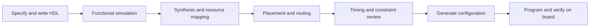

@@NOTE
Counters|计数器|Binary and decade counters|counters|Ch10
> [!SUMMARY] Quick recall · 英文速览
> A counter stores and advances through a specified sequence. Modulus is the number of distinct states in its repeating cycle, not necessarily the maximum binary value plus one for an arbitrary sequence.

## Core Definition · 核心定义

计数器 (counter) 是有指定状态序列的 [[Finite State Machine]]。n 位 binary counter 的完整计数范围 0–$2^n-1$，modulus=$2^n$。十进制 BCD decade counter 走 0–9，modulus=10，需要 4 位但不是 mod16。

$$q^+=\begin{cases}(q+1)\bmod M,&\text{up}\\(q-1)\bmod M,&\text{down}.\end{cases}$$

此整数式定义规则计数，不描述不规则序列的通用 next-state logic。q 是编码/整数值；M 是完整循环的状态数。

## Asynchronous versus Synchronous · 异步与同步

异步 ripple counter：只有第一级直接由外部 clock 驱动，后级用前级输出边沿驱动；变化逐级 ripple。同步 counter：所有 FF 使用同一 clock，组合条件决定某一位是否翻转。

| Feature | Ripple counter | Synchronous counter |
|---|---|---|
| Clock inputs | Cascade from preceding stages | Common clock |
| Intermediate transition codes | Often significant | Still possible from clock-to-Q mismatch |
| Delay model | Can accumulate through stages | Clock-to-Q plus control/decode logic |
| Typical design analysis | Check edge polarity and Q/NOT Q connections | Derive all next states from old state |

“Synchronous” does not imply zero physical delay or glitch-free decoding. It describes the clock relationship. Enable and load behavior can also differ from chip to chip.

## Derivation · 同步二进制翻转条件

up counter 的 bit0 每拍翻转；bit1 在旧 bit0=1 时翻转；biti 在全部较低位都是 1 时翻转。因此：

$$T_0=1,\qquad T_i=\prod_{j=0}^{i-1}Q_j\quad(i\ge1),\qquad Q_i^+=Q_i\oplus T_i.$$

down counter 把条件改为较低位全 0：$T_i=\prod_{j=0}^{i-1}\bar Q_j$。可用 JK with J=K=T 实现。

## Worked Examples · 例题

**3-bit up.** 011→100：旧低位 Q0=Q1=1，所以 T0=T1=T2=1，三位都翻转。100→101 时低位旧 Q0=0，只有 T0=1，其余为 0。

**Ripple delay.** n=4、每级 clock-to-Q worst case=8 ns，在需贯穿所有级的 rollover 事件中，最终状态可在 32 ns 后才到达。哪些转换会达到该延迟，取决于各级触发边沿与 Q/NOT Q 接法；普通对应 up ripple 模型中的 0111→1000、1111→0000 会贯穿四级。

**Frequency.** 完整 binary ripple counter 的 bit i 输出重复频率为 $f_{clk}/2^{i+1}$，50% duty 在完整稳态周期中成立。mod3 的 decode pulse 可每三拍重复，但 duty 可能为 1/3，不是自动 50%。

## Control Inputs · 控制输入

Clear、load、enable、direction 与 terminal-count 控制应由 function table 指定。若同步 load LOW 优先于 count enable，则 LOAD=0 时即使 count disabled 也会在下一边沿加载；若器件另有条件，不得移植该假设。

For a modulo-10 down counter, 0000 decrements to 1001, not to 1111. For a full four-bit binary down counter, 0000 goes to 1111. The word “decade” changes the sequence.

## Method and Exam English · 方法与答题

1. Determine intended state sequence and initial state.
2. Identify synchronous versus ripple clocks.
3. Write each FF input and active edge.
4. Compute next states, including control priority.
5. Count the distinct states before the first repeated state.

**Exam answer:** “The modulus is the length of the repeating state cycle reached from the specified initial state. Although four flip-flops can represent sixteen codes, this decade counter uses only ten of them.”

## Connections · 相关笔记

[[JK and T Flip-Flops]], [[Synchronous Counter Design]], [[Ring and Johnson Counters]], [[Cascaded Counters and Digital Clocks]], [[Propagation Delay and Logic Hazards]].
@@NOTE
Synchronous Counter Design|同步计数器设计|Counter excitation synthesis|counters|Ch10
> [!SUMMARY] Quick recall · 英文速览
> Design begins with the required sequence, then derives next-state bits and flip-flop excitation inputs. Don't-cares may simplify the implementation, but the resulting unused-state transitions still need checking.

## Design Method · 设计方法

状态图 → next-state table → excitation table → K-map → input equations → implementation → 全状态核对。DFF 的激励直接为 $D_i=Q_i^+$；TFF 为 $T_i=Q_i\oplus Q_i^+$；JK 用逐位 transition table。

不要把 current state 和 next state 的 bit 列混在一起；所有输入函数以 current Q 与控制输入表示。题目要求 DFF 时最终 equations 要给 D，而不是仅列 J/K。

## Worked Example 1 · Modulo-3 with recovery

设状态 00→01→10→00；unused 11→00，初态 00。

| Current | Next | D1 | D0 | Pulse P |
|---|---|---|---|---|
| 00 | 01 | 0 | 1 | 0 |
| 01 | 10 | 1 | 0 | 0 |
| 10 | 00 | 0 | 0 | 1 |
| 11 | 00 | 0 | 0 | 0 |

$$D_1=\bar Q_1Q_0,\quad D_0=\bar Q_1\bar Q_0,\quad P=Q_1\bar Q_0.$$

P 每三拍重复一次，frequency=$f_{clk}/3$，HIGH 一拍所以 duty=1/3。两位状态不意味着随便挑一位就能得到相同 duty 的波形；若要求 50% divide-by-3 输出，仅正沿更新的简单三态 decode 不能每 1.5 周期改变一次。

## Worked Example 2 · 指定非顺序计数

要求 0→5→1→2→7→6→3→4→0，使用三个 FF。按 Q2Q1Q0 排列：

| Current decimal | Current bits | Next bits |
|---|---|---|
| 0 | 000 | 101 |
| 1 | 001 | 010 |
| 2 | 010 | 111 |
| 3 | 011 | 100 |
| 4 | 100 | 000 |
| 5 | 101 | 001 |
| 6 | 110 | 011 |
| 7 | 111 | 110 |

使用 DFF 可得到一组简洁式：

$$D_2=\bar Q_2\bar Q_0+Q_1Q_0,$$
$$D_1=\bar Q_2\bar Q_1Q_0+Q_1\bar Q_0+Q_2Q_1,$$
$$D_0=Q_2\bar Q_1Q_0+\bar Q_2\bar Q_0+Q_1\bar Q_0.$$

由每位 next=1 的 minterms 配对而来。也可保留 canonical D equations 完成验证，再改用 JK 激励化简；D 方案与 JK 方案都是同一行为的不同实现。

## JK Design · JK 设计细节

例如 000→101：bit2 为 0→1，所以 J2=1,K2=X；bit1 0→0 所以 J1=0,K1=X；bit0 0→1 所以 J0=1,K0=X。所有行分别填表，然后每个 J/K 变量各自画 K-map。

A valid but not always minimal JK implementation is $J_i=Q_i^+$ and $K_i=\overline{Q_i^+}$. The excitation-table don't-cares can produce a smaller circuit because each input matters only for one current-state value.

## Verification and Review · 验证与复习

Check every state, not only a few clock pulses. Confirm cycle length, absence of unintended branches, reset entry, and unused-state behavior. For an up/down counter, include both direction values for each state.

**Exam question:** Why does a simplified JK expression sometimes omit the current bit itself?

**Answer:** When Q=0, K is irrelevant; when Q=1, J is irrelevant. These excitation don't-cares can eliminate literals while preserving the desired next state through the JK characteristic equation.

## Connections · 相关笔记

[[Counters]], [[JK and T Flip-Flops]], [[Karnaugh Map]], [[State Encoding and Unused States]], [[Finite State Machine]], [[Testbench and Functional Verification]].
@@NOTE
Cascaded Counters and Digital Clocks|级联计数器与数字时钟|Terminal count and frequency division|counters|Ch10
> [!SUMMARY] Quick recall · 英文速览
> Cascaded stages form a mixed-radix counter. A higher stage advances only when the lower stage wraps. In synchronous designs, keep a common clock and propagate an enable event rather than casually using decoded pulses as new clocks.

## Core Definition · 核心定义

低位 modulus $M_0$、高位 $M_1$，每低位完整循环让高位加一，则总 modulus=$M_0M_1$。推广到 k 级为 $\prod_iM_i$，前提是正确的 wrap/enable/load 行为。

Terminal count (TC) 指定最后有效状态的 decode；carry/rollover event 表示本次 clock 接受后会 wrap 的条件。两者不一定相同：禁用计数时 TC 可一直 HIGH，但不应让高位每拍都增加。

## Derivation · 同步级联

最低位 enable E0=global enable。高一级 $E_1=E_0\land(q_0=M_0-1)$；再一级 $E_2=E_1\land(q_1=M_1-1)$。所有 q 都从 edge 前状态读取。

For a synchronous load-on-terminal scheme, decode the last legal state M−1 so the next edge loads zero. Decoding M and then synchronously clearing on a later edge can introduce an extra state and change the modulus. Asynchronous clear-on-M uses a different timing model and may create short transient states.

## Worked Example 1 · 两级十进制

个位、十位各 mod10，组成 mod100。当前 09、E=1：个位 9→0、十位 0→1，同时变 10。当前 99：两位均 wrap 到 00。当前 09、E=0：保持 09，TC 虽为 1，但不产生接受事件。

若 input=10 kHz，个位 cycle=1 kHz，总 100-state cycle=100 Hz。两个 decade 级联是 divide-by-100，不是 divide-by-10。

## Worked Example 2 · 60进制时钟

seconds 0–59、minutes 0–59；当前 12:59:59，下一次 1 Hz tick 应得 13:00:00。更新前 seconds TC 与 minutes TC 同时为 1，因此小时 enable 在同一拍有效。

One possible two-digit seconds implementation uses units 0–9 and tens 0–5. Units rollover enables tens; tens rollover at 5 only matters when units also roll at 9. Decoding tens=5 alone would repeatedly advance minutes while displaying 50–59.

教学 12-hour 系统若用 1–12，12 后应加载 1；若编码 0–11，解码显示与 roll 条件需另外定义。不能把两个约定的 terminal state 混用。

## Worked Example 3 · Preset truncated count

16-bit full binary cycle 长度 65536。要求 modulus 40000，可从 preset P=65536−40000=25536=0x63C0 开始，数到 65535 后下一事件加载 P。

Number of visited states is $65535-25536+1=40000$. The +1 includes both endpoints. Check the loading event does not add an unintended separate waiting state; the scheme's count-enable and load semantics determine the actual cycle.

## Practical Timing · 实际时序

Decode glitches can falsely trigger a higher stage if used as a clock. A common-clock enable chain lets receiving FFs sample a condition under setup/hold constraints, although the enable path still contributes to critical timing.

For an odd modulus, a terminal decode pulse has one-cycle width and duty 1/M. The output repetition frequency is $f_{clk}/M$; pulse width and 50% square-wave requirements are separate specifications.

## Method and Exam English · 方法与答题

- Define each stage's legal range, reset value, and wrap event.
- Connect a higher enable to the accepted lower rollover, not just a static display value.
- 在“59→00”与“禁用时末态保持”两种边界上验证。

**Answer pattern:** “All stages use the same clock. The next stage is enabled only when the lower stage is enabled and currently at its terminal count. The combined modulus is the product of the individual legal cycle lengths.”

## Connections · 相关笔记

[[Counters]], [[Register Enable and Reset]], [[Decoder]], [[Traffic Light Controller]], [[Propagation Delay and Logic Hazards]], [[Digital Logic Troubleshooting]].
@@NOTE
Memory Arrays and Expansion|存储阵列与扩展|Memory depth and width|memory|Ch11
> [!SUMMARY] Quick recall · 英文速览
> N address bits select $2^N$ words. M data bits determine word width. Increasing width and increasing depth require different connections; capacity in bits is depth times width.

## Core Definition · 核心定义

存储阵列 (memory array) 有 depth 个 word，每个 word 含 width 个 bit。N-bit address、M-bit word 的教学模型：

$$D=2^N\text{ words},\quad W=M\text{ bits/word},\quad C=2^NM\text{ bits}.$$

地址 (address) 是位置，不是所存 data value；word line 选择行，bit lines 连接各列。enable 的实际极性与读写时序取决于具体 memory interface。

## Derivation · 行列与译码

每个地址模式对应一行，[[Decoder]] 将 binary address 转为 one-hot row selection；被选行向 M 个数据端输出/接收 word。若芯片有 row/column multiplexed address，外部引脚数与完整地址位数可能不一样，不能机械套用“引脚数=N”。

Random access means locations can be directly selected by address. It does not mean random contents or that all accesses have identical latency in every modern memory organization.

## Worked Example 1 · 容量与地址

8K×16 表示 8192 words，每 word=16 bit。N=13；capacity=$8192\times16=131072$ bit=16384 byte=16 KiB。word 地址范围 0x0000–0x1FFF。若系统 byte-addressed，则映射整个 16 KiB 区域需要考虑每 word 两个 byte，不能直接把 word address 当 byte address。

**Small lookup.** $2^2\times3$ memory 有 4 words、每 word3位、总12 bit；地址10只选择第三行，不表示“读数值 2”。

## Width Expansion · 位宽扩展

两片 8K×8 组成 8K×16：共享同一 address 与正确读写控制，一片数据接低8位，一片接高8位，两片一起选中。depth 不变，width 加倍。

Do not connect both chips to the same eight data wires when the goal is width expansion. That creates two drivers on each wire instead of a sixteen-bit word.

## Depth Expansion · 深度扩展

两片 8K×8 组成 16K×8：低13位地址同时接两片；第14位地址选择 chip；数据线共用，但仅被选片可驱动。depth 加倍，width 不变。

四片 8K×8 构造 16K×16：两个 bank，每 bank 两片并排扩宽；地址高位选 bank，各 bank 内两片同步工作。所需数量=(16K/8K)×(16/8)=4。

## Interface and Timing · 接口与时序

读操作不一定是组合 read：异步 memory 可在地址稳定后输出；同步 memory 可能在 clock 边沿采地址并在稍后输出。Write enable、chip select、output enable 与 tri-state bus rules 必须一起检查。

For depth expansion, inactive chips must release a shared read bus or be selected through explicit multiplexing. A correct capacity calculation alone does not specify a working bus interface.

## Method and Review · 方法与复习

1. Normalize K/M prefixes into the specified word counts.
2. Calculate address bits from depth, not capacity in bits.
3. Calculate bit capacity and convert to bytes if divisible by eight.
4. Draw bank/width grouping and chip-select conditions.
5. Check bus ownership and read/write timing.

**Exam question:** Does doubling the word width require another address bit?

**Answer:** No. The same number of words is still addressed. Doubling depth requires one additional binary address bit for a power-of-two organization; doubling width increases the number of data bits instead.

## Connections · 相关笔记

[[Bits and Bytes]], [[Hexadecimal Number System]], [[Decoder]], [[Tri-State Buffers and Bus Drivers]], [[SRAM DRAM and ROM]], [[Read-Only Memory and Programmable Logic Arrays]].
@@NOTE
SRAM DRAM and ROM|SRAM、DRAM与ROM|Memory technologies|memory|Ch11
> [!SUMMARY] Quick recall · 英文速览
> SRAM stores state with feedback; DRAM stores charge and needs refresh. Both conventional RAM types are volatile. ROM-family storage is nonvolatile, but modern reprogrammable variants have distinct write and erase rules.

## Core Definition · 核心定义

volatile 指断电后不保证保存内容；nonvolatile 指在规定条件下断电仍可保持。Static 指不需要周期 refresh，**不表示断电不丢失**。Dynamic 指 stored charge 需要恢复，并不是“动态可变编程”。

| Technology | Storage mechanism | Refresh | Power-off retention | Typical role |
|---|---|---|---|---|
| SRAM | Bistable feedback, often 6T cell | No periodic refresh | Volatile | Fast buffers/cache |
| DRAM | Capacitor charge, basic 1T1C model | Required | Volatile | Dense main memory |
| Mask ROM | Fabricated connections/data | No | Nonvolatile | Fixed lookup data |
| EEPROM/Flash | Programmable nonvolatile cells | No DRAM-style refresh | Nonvolatile within rated conditions | Persistent configuration/data |

Exact speed, density, endurance, and retention are device-specific. The comparison explains mechanisms; it is not a source of universal numerical guarantees.

## SRAM Mechanism · SRAM 机制

交叉 inverter 的两个稳定状态保存 Q，与 [[Set-Reset Latch]] 的 bistable 原理相近。access transistors 在 wordline 有效时连接 bitlines，用于读写。具体 6T SRAM 的 read/write stability 还涉及 transistor strength，不能把任意 NOR latch 直接当真实 bit-cell schematic。

As long as power and operating conditions are maintained, the feedback restores the stored logic level without periodic refresh. Losing power removes that sustaining mechanism.

## DRAM Mechanism · DRAM 机制

电容存电荷 $Q=CV$；leakage current $I$ 使近似电压损失 $\Delta V=I\Delta t/C$，因此隔一段时间需 refresh。教学读模型是 charge sharing，reading perturbs stored charge，sense amplifier 判定并 restore；外部看来一次正常 read 不应把用户数据丢掉。

**Illustrative check.** C=30 fF、leakage=1 fA、允许下降0.1 V，则 $\Delta t=C\Delta V/I=3$ s。若 I=100 fA，同样模型得30 ms。这个例子说明 leakage 与 refresh 间隔关系，不是任何 DRAM 的规定刷新时间。

## ROM and Reprogramming · ROM 与重写

Mask ROM 在制造时固定；PROM 常为一次编程；EPROM/EEPROM/Flash 可按各自机制擦写。Flash 通常按 block erase、按较小单位 program，有 endurance 限制。课程广义 ROM 类包括这些非易失存储，但它们不是“永远不可写”的同一器件。

Memory used as a truth-table lookup is conceptually separate from the technology storing its entries. A RAM initialized with a table can perform the same combinational lookup function as a ROM if its read interface supplies the required timing and the entries remain unchanged.

## Worked Examples and Review · 例题与复习

**Power loss.** SRAM 里计数值123、Flash 里参数123。断电后 SRAM 不保证保留；Flash 的保留也需符合器件条件，不是无限年承诺。

**Classification.** “DRAM must periodically refresh” is correct in the usual model. “SRAM is nonvolatile” is false. “Random access means read-only” is false; access pattern and writability are different dimensions.

**Exam answer:** “SRAM uses a stable feedback state and needs power but no periodic refresh. DRAM uses stored charge that leaks and is disturbed by sensing, so refresh and restoration preserve the data.”

## Connections · 相关笔记

[[Memory Arrays and Expansion]], [[Set-Reset Latch]], [[Read-Only Memory and Programmable Logic Arrays]], [[Field-Programmable Gate Array]], [[Digital Abstraction and System Design]].
@@NOTE
Read-Only Memory and Programmable Logic Arrays|ROM与可编程逻辑阵列|ROM LUT PLA PAL|memory|Ch11
> [!SUMMARY] Quick recall · 英文速览
> A ROM implements a truth table by addressing stored outputs. A PLA implements selected product terms and OR combinations. A LUT is a small programmable truth table used inside FPGA logic.

## Core Definition · 核心定义

用 N-bit 输入作为地址，M-bit stored word 作为 M 个输出，就把 truth table 写入 $2^N\times M$ array。ROM 的 address decoder 产生所有 minterms；output connections/data 指定哪些行给1。

PLA (programmable logic array) 有可配置 AND 与 OR 阵列，按所需 product terms 实现 SOP；PAL 的经典模型为 programmable AND、fixed OR。这里 programmability 指配置连接；固定结构/布线资源不等于“所有连接不可编程”。

## Derivation · ROM 编程表

要求地址 A1A0 时输出 $(X,Y,Z)=(A_1\oplus A_0,A_1+A_0,A_1A_0)$：

| Address | X | Y | Z | Stored XYZ |
|---|---|---|---|---|
| 00 | 0 | 0 | 0 | 000 |
| 01 | 1 | 1 | 0 | 110 |
| 10 | 1 | 1 | 0 | 110 |
| 11 | 0 | 1 | 1 | 011 |

Capacity=4×3=12 bit。若存储输出顺序改为 ZYX，word 必须相应重排；所有 bit 格子的 dots/0/1 都应按明确极性读。

The address bits select a row; they are not ANDed numerically with the stored word. The output is the entry stored at that row, after the specified access delay.

## Worked Example · PLA 共享乘积

要求 $X=\bar ABC+A\bar BC$，$Y=\bar AB$。定义 $P_1=\bar ABC$、$P_2=A\bar BC$、$P_3=\bar AB$；X=P1+P2，Y=P3。若另一个输出也用 P1，可共享该 product term。

| Product | A | B | C | Connect to X | Connect to Y |
|---|---|---|---|---|---|
| P1 | Complement | True | True | Yes | No |
| P2 | True | Complement | True | Yes | No |
| P3 | Complement | True | Unused | No | Yes |

“Unused” in the AND-array table means omit that literal from the product; it does not mean drive an input wire to floating X. For A,B,C=0,1,1, P1=P3=1, giving X=Y=1. For 1,0,1, X=1,Y=0.

## ROM versus PLA versus LUT · 对比

- ROM/LUT：explicitly store every input combination，适合任意 truth table。
- PLA：store/select useful implicants，适合可共享且简化后的 SOP。
- N-input single-output LUT needs $2^N$ configuration bits; a 4-input LUT needs16。
- A larger logic function may use several LUTs and routing; a LUT's stored table does not by itself add sequential state to the user function.

Configuration storage is different from runtime state. A LUT output can be combinational even though its truth table is stored in memory. A separate FF produces clocked behavior.

## Method and Exam English · 方法与答题

1. Fix input address order and output bit order.
2. Enumerate the full truth table for ROM/LUT.
3. For PLA, minimize each output and identify shareable products.
4. Check selected-row and connection polarity.
5. Confirm the timing of read versus registered output.

**Exam answer:** “The ROM stores the output vector for each address pattern. The PLA instead generates selected product terms and combines them into outputs. Both realize the specified Boolean functions, but their internal representations and resource costs differ.”

## Connections · 相关笔记

[[Sum-of-Products Form]], [[Minterm and Maxterm]], [[Decoder]], [[Memory Arrays and Expansion]], [[Field-Programmable Gate Array]], [[Seven-Segment Display and Code Conversion]].
@@NOTE
Field-Programmable Gate Array|现场可编程门阵列|FPGA|programmable-logic|Ch11
> [!SUMMARY] Quick recall · 英文速览
> An FPGA maps hardware descriptions onto configurable logic, registers, routing, and other resources. Simulation checks a model; implementation and timing analysis check whether the mapped design meets the physical constraints.

## Core Definition · 核心定义

FPGA 是可在现场配置的集成电路。教学 logic element 通常包括 LUT、FF、MUX；器件还可有 carry resources、RAM、DSP 与 I/O。具体 LUT 输入数和 architecture 依器件，不应把某个例子的 four-input LUT 当成所有 FPGA 的定义。

LUT 执行 combinational function，FF 保存 runtime state，routing 连接模块。HDL 描述的多个 concurrent statements 对应并行硬件；不是 CPU 把每行逐条执行。

## Design Flow · 设计流程



Synthesis 将行为/结构转为可实现逻辑；implementation 决定资源放置与连接；bitstream/configuration 配置器件。Behavioral simulation 成功不能代替物理 timing review。

## Worked Example · 四位 enabled register

功能 $Q^+=EN?D:Q$：需要保存4位，因此通常对应4个 FF；输入选择由 MUX/FF内 enable resource 实现。若同 clock 下 q<=d，没有 EN，不能因为时钟 HIGH 持续很久就让 q 透明跟随。

**LUT capacity.** 一个4输入、1输出 LUT 存16个 truth bits。要直接表示任意5输入、1输出函数，完整 table有32 bit；可分解为两个4-input cofactors 再 MUX，或按目标设备其他资源实现。资源估算不是实际综合 report。

## Constraints and Interfaces · 约束与接口

必须指定 top-level ports、target device、clock period、I/O pin mapping 与电气标准，涉及板上连接时核对该 board 的资料。讲义中的旧版 Vivado 菜单和示例引脚是历史演示；本篇保留阶段逻辑，不当作当前安装版本的操作保证。

An unconstrained clock can leave a design without a meaningful required frequency. An incorrect pin constraint can produce the right simulated waveform on the wrong physical pin. These are different failures, so inspect both logic and interface constraints.

不把普通输入按钮当 clock；先同步/debounce 并产生 enable event。内部多驱动 `X` 或未赋值 latch 应在 simulation/synthesis warnings 中追查。

## Practical Review · 实践与复习

| Evidence | Supports | Does not by itself prove |
|---|---|---|
| Functional simulation | RTL behavior on tested stimuli | Timing closure or electrical wiring |
| Synthesis report | Mapped registers and logic | Correct external pin assignment |
| Timing report | Constrained timing paths | Correct functional specification |
| Board observation | Tested physical behavior | All untested states and interfaces |

**Exam question:** Why does a memory-based LUT still implement combinational logic?

**Answer:** Its configuration bits define a fixed truth table during operation. Current inputs address that table and determine the output. Clocked user state requires a register or another state element; configuration memory alone does not make the function depend on prior inputs.

## Connections · 相关笔记

[[Read-Only Memory and Programmable Logic Arrays]], [[Sequential Logic]], [[VHDL Language and Modeling]], [[Structural Shift Register Project]], [[Testbench and Functional Verification]], [[Setup and Hold Timing]].
@@NOTE
VHDL Language and Modeling|VHDL语言与建模|VHSIC Hardware Description Language|hardware-description|HDL
> [!SUMMARY] Quick recall · 英文速览
> An entity defines an interface; an architecture defines its implementation. Statements in a process run sequentially during an activation, while processes and concurrent statements describe concurrent hardware.

## Core Definition · 核心定义

VHDL 是 hardware description language。entity 声明 ports，architecture 声明内部 signals 与逻辑。dataflow 用 concurrent equations，structural 用 instances/port map，behavioral 常用 process 描述。不同风格可以描述相同的硬件。

采用 `IEEE.std_logic_1164` 的 logic types；算术用 `IEEE.numeric_std` 中 `unsigned`/`signed` 明确数值含义。`std_logic_vector` 本身是一组逻辑值，没有自动确定的 signed 数值解释。

## Types and Operators · 类型与运算

| Form | Meaning | Important boundary |
|---|---|---|
| `'0'`, `'1'` | Scalar logic literal | Single quotes |
| `"1010"` | Vector literal | Double quotes |
| `<=` assignment | Schedule a signal value | Relational `<=` in a condition has another meaning |
| `:=` | Variable assignment | Immediate within that execution |
| `&` | Concatenation | Order determines bit position |
| `unsigned(v)` | Explicit numeric interpretation | Does not add an extra sign bit |
| `rising_edge(clk)` | Detect valid rising transition | Use for a synchronous capture event |

`std_logic` 的 U/X/Z 等为模拟信息；resolved type 可以计算多个 driver 的 resolution，不能因此任意短接真实输出。`std_ulogic` 可帮助发现不允许的多驱动。

## Concurrent and Sequential Semantics · 并发与顺序语义

```vhdl
-- Concurrent dataflow: both equations exist at the same time.
p <= a xor b;
s <= p xor cin;
```

p 更新会在仿真的后续 delta cycle 触发 s 更新；零时间 delta 是模拟调度，不是实际门延迟。把两个语句上下交换，不改变此 dataflow network。

```vhdl
process(clk)
begin
  if rising_edge(clk) then
    q1 <= d;
    q2 <= q1;
  end if;
end process;
```

q2 读旧 q1，所以是两个寄存器级，不是同一边沿 d 直接到 q2。变量赋值 `v := d; q2 <= v;` 则 q2 读取本次新 v；语言语义改变了数据路径。

## Combinational versus Clocked Process · 组合与时钟过程

```vhdl
process(a, b, sel)
begin
  y <= a;                 -- default assigns all paths
  if sel = '1' then
    y <= b;
  end if;
end process;
```

Explicit sensitivity lists must include all read signals for this combinational model. `process(all)` is the VHDL-2008 alternative when the configured tool mode supports it. Omitting a required signal can make simulation stale while synthesis still builds input-dependent logic.

如果 combinational process 的某些路径不给 y 赋值，就表示保留旧值，可能推断 latch。clocked process 省略 inactive-edge assignment 是正常 FF hold；同样的“不赋值”要结合事件结构判断。

## Reset Examples · 复位例题

```vhdl
-- Synchronous, active-high reset; reset outranks enable.
process(clk)
begin
  if rising_edge(clk) then
    if rst = '1' then
      q <= (others => '0');
    elsif en = '1' then
      q <= d;
    end if;
  end if;
end process;
```

Asynchronous reset moves the reset test before `rising_edge` and includes rst in `process(clk, rst)`. A reset inside the rising-edge conditional cannot reset between edges merely because rst appears in the sensitivity list.

## Worked Examples · 例题

**Unsigned comparison.** `greater <= '1' when unsigned(a) > unsigned(b) else '0';`，对 a=1000,b=0111 得1。换为 `signed` 时 a=−8,b=7，输出0。类型决定 interpretation，位串本身没有改变。

**Width.** 两个4位 unsigned 相加可能需要5位。先 `resize` operands 到5位再加才能保留 carry；只把4位结果赋给5位目标，不能保证此前被截掉的 carry 自动回来。

**Process trap.** `if en='1' then q<=d; end if;` 在 level-sensitive `process(en,d)` 中是 latch；在 `if rising_edge(clk)` 内则是 enabled FF。所谓 “behavioral is sequential” 只描述语句执行顺序，不意味着必然生成时序电路。

## Coding Review and Boundaries · 编写检查与边界

- Basic identifiers are case-insensitive; avoid consecutive/trailing underscores and reserved words.
- Use ordinary straight quotes and matching `end if`, `end process`, and architecture boundaries.
- Named port maps make connection intent clearer than long positional lists.
- Do not use `inout` merely to read an ordinary output; use an internal signal. Output readability also depends on the language revision.
- `'-'` is a simulation logic value, not automatic wildcard equality; use an explicit matching operation or specified synthesis don't-care treatment.

The snippets explain language and hardware behavior. Their enclosing declarations, vector widths, and library context must be supplied consistently before compiling. They are not a claim that a particular installed tool version was tested.

## Exam English and Connections · 答题与关联

**Answer:** “The two signal assignments inside the clocked process both evaluate their right-hand sides using the pre-update signal values. Therefore q2 receives the previous q1 and the circuit forms a two-stage register chain.”

[[Combinational Circuit]], [[Sequential Logic]], [[D Latch and D Flip-Flop]], [[Register Enable and Reset]], [[Tri-State Buffers and Bus Drivers]], [[Structural Shift Register Project]], [[Testbench and Functional Verification]].
@@NOTE
Structural Shift Register Project|结构化双向移位寄存器项目|Structural VHDL shift register|hardware-description|HDL
> [!SUMMARY] Quick recall · 英文速览
> Structural modeling instantiates storage elements and connects explicit next-state logic. A bidirectional register is a bank of DFFs preceded by direction-controlled data selection.

## Specification and Boundary · 规范与边界

本教学实现 4 个正沿 DFF；高有效 asynchronous reset；状态按 q(3 downto 0) 阅读，right_left=1 表示数值向低位 right shift，SR 进入 q3；right_left=0 left shift，SL 进入 q0。两侧输入单独提供。如果原图编号方向不同，先重写映射再接线，不能把本模型误标为原图逐引脚复制。

$$d_3=R\cdot SR+\bar Rq_2,\quad d_2=Rq_3+\bar Rq_1,$$
$$d_1=Rq_2+\bar Rq_0,\quad d_0=Rq_1+\bar RSL.$$

R=right_left。每条式子是两个 AND 加 OR 的二选一逻辑；四个 d 由同一旧 q 计算。

## Reusable DFF · 基础触发器

下面是独立的完整 design unit：

```vhdl
library ieee;
use ieee.std_logic_1164.all;

entity dff_ar is
  port(clk, rst, d : in std_logic;
       q : out std_logic);
end entity;

architecture rtl of dff_ar is
begin
  process(clk, rst)
  begin
    if rst = '1' then
      q <= '0';
    elsif rising_edge(clk) then
      q <= d;
    end if;
  end process;
end architecture;
```

Reset has priority and acts without waiting for the clock. A synchronous version would place the reset test inside the rising-edge branch. Do not silently switch those semantics when reusing the component.

## Structural Top Level · 结构化顶层

```vhdl
library ieee;
use ieee.std_logic_1164.all;

entity bidir4 is
  port(clk, rst, right_left, sr, sl : in std_logic;
       q : out std_logic_vector(3 downto 0));
end entity;

architecture structural of bidir4 is
  signal qi, di : std_logic_vector(3 downto 0);
begin
  di(3) <= (right_left and sr)
       or ((not right_left) and qi(2));
  di(2) <= (right_left and qi(3))
       or ((not right_left) and qi(1));
  di(1) <= (right_left and qi(2))
       or ((not right_left) and qi(0));
  di(0) <= (right_left and qi(1))
       or ((not right_left) and sl);

  stages : for i in 0 to 3 generate
    ff : entity work.dff_ar(rtl)
      port map(clk => clk, rst => rst,
               d => di(i), q => qi(i));
  end generate;
  q <= qi;
end architecture;
```

This uses structural DFF instances and explicit Boolean gate equations. If the learning requirement additionally asks for every AND/OR as an instance, create those gate entities and replace the equations with named port maps without changing the truth functions. Compile `dff_ar` before the top-level entity.

## Worked Example · 从零串入后反向

reset 后0000，R=1，SR依次1,0,1,1，四次 edge 后状态1000、0100、1010、1101。再 R=0、SL=0，下一 edge 到1010；再SL=1，下一edge到0101。每一步和 [[Shift Registers]] 的 recurrence 一致。

若 R 在 edge 附近变化，四个 d 的选择都可能违反 setup/hold；“方向只影响组合门”不表示它无需同步。实际按钮控制请先执行 [[Metastability and Clock Domain Crossing]] 的接口处理。

## Verification Plan · 验证路径

1. Test the DFF independently: edge capture and asynchronous reset.
2. Test right shift with several serial patterns from known initial state.
3. Test left shift and direction changes between edges.
4. Assert reset between edges and confirm immediate logical clearing.
5. Check all 16 old words × 2 directions × 4 serial-input pairs in a reference model.
6. Compare old-state-derived next words with the structural simulation trace.

行为模型可写 `qi <= sr & qi(3 downto 1)` 或 `qi <= qi(2 downto 0) & sl`，用于对照，并不能替代要求练习 port-map 的结构实现。

## Pitfalls and Exam English · 误区与答题

- Four FFs have one shared clock, not a clock derived from adjacent Q.
- Don't use a variable loop that repeatedly shifts a newly updated word during one edge.
- Internal `qi` provides feedback and avoids depending on output-port readability.
- Testbench signals and synthesizable entities belong to different roles.

**Answer:** “Direction selects the data source for each D input. At the active edge, all four DFFs capture simultaneously, so each bit moves exactly one stage using the previous register contents.”

## Connections · 相关笔记

[[VHDL Language and Modeling]], [[D Latch and D Flip-Flop]], [[Shift Registers]], [[Multiplexer and Demultiplexer]], [[Testbench and Functional Verification]], [[Field-Programmable Gate Array]].
@@NOTE
Testbench and Functional Verification|测试平台与功能验证|Self-checking HDL testbench|hardware-description|HDL
> [!SUMMARY] Quick recall · 英文速览
> A testbench supplies stimuli and compares outputs with an independently stated expected behavior. A waveform is useful evidence, but assertions and coverage make failures and untested cases explicit.

## Core Definition · 核心定义

测试平台 (testbench) 没有外部硬件 ports，通过时钟、复位与输入激励驱动 DUT (design under test)。它包含 wait/assert 等 simulation constructs，不用于作为板上硬件顶层综合。

Golden/reference model 来自规范；若直接复制 DUT 的同一错误表达式，比较会一起错。状态向量更新、边沿前后窗口、reset priority 必须明确。

## Complete Minimal Example · 完整小型例子

此 testbench 对 [[Structural Shift Register Project]] 的 bidir4 interface，仿真 clock=10 ns，输入在远离 rising edge 的时刻设置：

```vhdl
library ieee;
use ieee.std_logic_1164.all;

entity tb_bidir4 is
end entity;

architecture sim of tb_bidir4 is
  signal clk : std_logic := '0';
  signal rst : std_logic := '1';
  signal r, sr, sl : std_logic := '0';
  signal q : std_logic_vector(3 downto 0);
  signal done : boolean := false;
begin
  dut : entity work.bidir4(structural)
    port map(clk => clk, rst => rst,
             right_left => r, sr => sr, sl => sl, q => q);

  clock_gen : process
  begin
    while not done loop
      clk <= '0'; wait for 5 ns;
      clk <= '1'; wait for 5 ns;
    end loop;
    wait;
  end process;

  stimulus : process
    variable expected : std_logic_vector(3 downto 0);
    constant bits : std_logic_vector(0 to 3) := "1011";
  begin
    wait for 2 ns;
    assert q = "0000" report "reset failure" severity failure;
    rst <= '0'; r <= '1'; sl <= '0';
    expected := "0000";
    for i in 0 to 3 loop
      sr <= bits(i);
      wait until rising_edge(clk);
      expected := bits(i) & expected(3 downto 1);
      wait for 1 ns;
      assert q = expected report "right shift failure" severity failure;
      wait until falling_edge(clk);
    end loop;

    r <= '0'; sl <= '0';
    wait until rising_edge(clk);
    expected := expected(2 downto 0) & '0';
    wait for 1 ns;
    assert q = expected report "left shift failure" severity failure;

    wait for 1 ns;
    rst <= '1';
    wait for 1 ns;
    assert q = "0000" report "async reset failure" severity failure;
    done <= true;
    report "directed checks passed" severity note;
    wait;
  end process;
end architecture;
```

Assertions wait beyond zero-time signal scheduling. Here 1 ns is a deliberate check delay in a zero-delay behavioral model, not a guaranteed physical FF delay. A timing simulation needs an observation point compatible with its actual delays.

## Trace and Coverage · 波形与覆盖

预期 right-shift state=1000、0100、1010、1101；left step=1010；异步 reset=0000。q 的物理预期参考 bit order 与 design 一致。

The code is a directed teaching example, not exhaustive verification. To extend it, enumerate all initial states using a loading/initialization method permitted by the interface, then test both directions and all SR/SL pairs. If the design has no parallel load, reach states through a defined serial loading sequence rather than forcing internal state in the normal functional test.

## Test Dimensions · 测试维度

| Dimension | Examples | Catches |
|---|---|---|
| Data | All zero, all one, alternating, isolated 1 | Missing/shorted stages |
| Direction | Both modes and switches | Reversed mappings |
| Reset | Initially and between edges | Wrong reset semantics |
| Boundary | Edge-adjacent changes where specified | Timing model errors |
| State | Every reachable old word | Incomplete next-state logic |
| Unknowns | Unexpected U/X | Missing initialization/drivers |

不要只把一张“看起来合理”的 waveform 当通过依据；应标出 stimulus、expected、observed 与失败条件。功能仿真通过仍需 FPGA constraints、timing 与板上验证。

## Method and Exam English · 方法与答题

1. Read the DUT interface and behavior specification.
2. Choose an independently understandable reference recurrence.
3. Apply inputs away from capture edges for ordinary functional tests.
4. Observe after model updates and compare with assertions.
5. Report what was covered and what still needs testing.

**Question:** Why can an assertion immediately after `wait until rising_edge(clk)` see the old Q?

**Answer:** The clock event wakes processes, and their signal assignments are scheduled for later update cycles. An assertion in the same activation can run before Q has updated. Wait for the appropriate delta cycles or a specified observation delay before comparing.

## Connections · 相关笔记

[[VHDL Language and Modeling]], [[Structural Shift Register Project]], [[Sequence Detector]], [[Synchronous Counter Design]], [[Field-Programmable Gate Array]], [[Setup and Hold Timing]].
