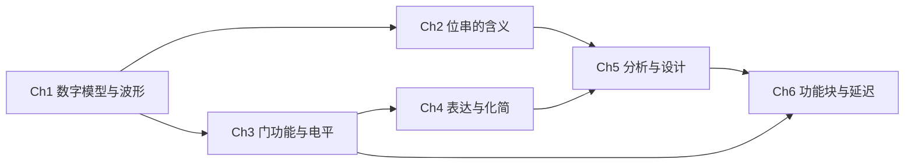

---
tags:
  - ECE2050
  - review
date: 2026-10-20
updated: 2026-10-20
chapter: Ch1–6
aliases:
  - Midterm Knowledge Outline
  - ECE2050 期中知识大纲
  - 数字逻辑期中复习知识清单
---

# Midterm Knowledge Outline · 期中知识大纲

> [!SUMMARY] Scope and use · 范围与用法
> 覆盖 **Ch1–6**，用于建立知识结构和检查掌握程度。解释不清时读 [[Midterm Review Guide]]；闭卷写公式后对照 [[Midterm Formula Sheet]]；最后用 [[Midterm Practice and Answers]] 检验。只有能独立说明条件并完成对应题目，才勾选掌握目标。
>
> Ch1 中的触发器、寄存器、计数器和状态机只要求认识功能与“有状态”的含义；Ch7–11 的详细设计不纳入此大纲。小型乘法器按 Ch6 章末问题与现有复习资料掌握部分积和位权连接。

## 0 · Connections · 六章之间的联系

做综合题依次检查：**表示是否明确 → 逻辑是否正确 → 实现是否满足条件**。位宽与编码贯穿算术；有效极性贯穿门图、编解码与显示；真值表贯穿化简与实现；时间条件决定正确输出何时可用。

## 1 · Ch1: Digital Foundations · 数字基础

**知识树**

- 数字抽象 (digital abstraction)：连续电压 → 电压区间 → 离散逻辑值；模拟量与数字量。
- 逻辑解释：正逻辑 (positive logic)、高/低电平；有效极性 (active polarity)、低有效 (active-low)。
- 系统模块：组合逻辑 (combinational logic) 只依赖当前输入；时序逻辑 (sequential logic) 含状态与历史。
- 数字波形 (digital waveform)：周期 (period)、频率 (frequency)、占空比 (duty cycle)、脉宽 (pulse width)、上升/下降时间 (rise/fall time)、传播延迟 (propagation delay)。
- 系统组织：抽象、层次化 (hierarchy)、模块化 (modularity)、规则性 (regularity)；固定功能与可编程集成电路 (integrated circuit, IC)、集成规模与封装。

**掌握目标**

- [ ] 能说明“实际电压连续”与“信息按 0/1 解释”如何同时成立。
- [ ] 能区分加法器、比较器、选择器与触发器、寄存器、计数器的作用。
- [ ] 能从波形读出周期和有效时间，计算频率、占空比，并区分边沿时间与输入到输出延迟。

**公式类别：** [[Midterm Formula Sheet#1 · Waveforms and Bit Counts · 波形与位宽|§1 周期、频率、占空比与码数]]。

**最常见易错点：** 把 LOW 当成“不工作”；把正逻辑与低有效视为矛盾；把两种状态误认为能存两位；把上升时间当传播延迟。

专题：[[Digital Foundations and Waveforms]]。自测：[[Midterm Practice and Answers]] 题 **1–2**。

## 2 · Ch2: Representation and Coding · 数值表示与编码

**知识树**

- 数制与位权 (number systems and positional weights)：整数/小数转换，二、八、十六进制分组，码数与最少位宽。
- 整数解释：无符号 (unsigned)、原码 (sign-magnitude)、补码 (two's complement)、偏置表示 (biased representation)。
- 定宽算术：求负、加减乘除、符号扩展 (sign extension)、进位 (carry) 与有符号溢出 (signed overflow)。
- 定点数 (fixed-point)：本课 U a.b / Q a.b；尺度、范围、精度、量化 (quantization)、饱和运算 (saturating arithmetic) 与回绕 (wraparound)。
- 浮点数 (floating-point)：IEEE 754 binary32 的符号、偏置指数、小数字段；正规数及特殊字段。
- 数据编码：二进制编码十进制 (binary-coded decimal, BCD) 与加六修正；反射格雷码 (binary-reflected Gray code)；ASCII 字符编码。
- 检错：奇偶校验 (parity)；循环冗余校验 (cyclic redundancy check, CRC) 的 XOR 除法与余数。

**掌握目标**

- [ ] 给定同一位串，能按声明的位宽和编码分别解码；转换后能按位权反算。
- [ ] 能做定宽补码加减和简单乘除，分别报告保留结果、进位、溢出及边界情况。
- [ ] 能由小数位数确定定点尺度与范围，区分舍入、截断、饱和、回绕。
- [ ] 能编码/解码 binary32，先检查指数字段，再判断是否有隐含前导 1。
- [ ] 能完成 BCD、Gray、ASCII、奇偶和 CRC 题，并说明每种码的用途与检错边界。

**公式类别：** [[Midterm Formula Sheet]] **§1–4**：位宽、位权与范围、补码溢出、定点尺度、binary32 分类、BCD 修正、Gray 转换、奇偶位、CRC。

**最常见易错点**

- 表示 0 到某上限时漏数 0；不声明编码就解释最高位；把最高位进位当补码符号或溢出。
- 本课 Q a.b 的 a **包含符号位**；正规 binary32 实际指数范围为 −126…127；特殊指数不能直接套正规数公式。
- BCD 不是整个十进制数的普通二进制；Gray 解码是累积 XOR；CRC 补零数是生成码位数减一。
- 奇偶/CRC 检查通过只表示未检出错误，不保证没有错误。

专题：[[Number Systems and Base Conversion]]、[[Binary Arithmetic and Signed Representation]]、[[Fixed-Point and Floating-Point Numbers]]、[[Data Coding and Character Representation]]、[[Parity and Cyclic Redundancy Checks]]。自测：题 **3–13**。

## 3 · Ch3: Gates and Interfaces · 逻辑门与电平接口

**知识树**

- 门功能：NOT、buffer、AND、OR、NAND、NOR、XOR、XNOR；符号、表达式、真值表与波形四种表示。
- 控制值 (controlling value) 与非控制值：决定门控和故障能否向后传播。
- 电平保证：发送端输出上/下界与接收端输入门限；静态传输特性 (DC transfer characteristic)。
- 噪声容限 (noise margin)：高、低两侧分别比较，分别判断接口方向。

**掌握目标**

- [ ] 能逐时间区间分析门输出，区分二输入 XOR 判不同与多输入 XOR 判奇偶。
- [ ] 能认清四个门限参数分别属于发送端还是接收端，并计算两侧噪声容限。
- [ ] 能根据给定静态曲线解释逻辑区间，不从静态曲线推断传播延迟。

**公式类别：** [[Midterm Formula Sheet#5 · Logic Gates · 门与真值表|§5 门函数与真值表]]、[[Midterm Formula Sheet#6 · Electrical Levels · 电平、静态曲线与噪声|§6 电平保证与噪声容限]]。

**最常见易错点：** 用电源电压代替输出保证；只检查 HIGH；交换发送/接收端仍沿用原结果；认为落入未保证区就必然翻转；把真实门限统一设为半电源电压。

专题：[[Logic Gates and Boolean Functions]]、[[Logic Levels and Noise Margins]]。自测：题 **14–15**；故障传播联系题 **24**。

## 4 · Ch4: Boolean Algebra and K-Maps · 布尔代数与卡诺图

**知识树**

- 组合电路模型：组合元件、内部节点唯一驱动、无有向反馈环。
- 布尔定律 (Boolean laws)：交换、结合、分配、幂等、互补、吸收、德摩根 (DeMorgan)；对偶与穷举验证。
- 表达形式：字面量 (literal)、积之和 (sum of products, SOP)、和之积 (product of sums, POS)。
- 标准式 (canonical form)：最小项 (minterm)、最大项 (maxterm)、变量顺序、真值表行号。
- 卡诺图 (Karnaugh map, K-map)：Gray 排列、首尾相邻、矩形覆盖、重叠、必要覆盖、无关项 (don't-care)。

**掌握目标**

- [ ] 能说明每一步代数化简依据，并区分求对偶与对整个函数取反。
- [ ] 能从真值表写标准 SOP/POS，也能把缺变量的一般项补成标准项。
- [ ] 能分别圈 1 求 SOP、圈 0 求 POS，检查跨边界相邻及各组保留的变量。
- [ ] 能按规格决定无效输入是 X 还是指定值，并验证所有规定输入。

**公式类别：** [[Midterm Formula Sheet#7 · Boolean Laws · 布尔定律|§7 定律、德摩根与共识关系]]、[[Midterm Formula Sheet#8 · Canonical Forms and K-Maps · 标准式与卡诺图|§8 标准式、行号与 K-map]]。

**最常见易错点：** 用普通二进制顺序排 K-map；圈对角线或非二次幂格数；漏覆盖指定格；把 X 当成必须覆盖的 1；用最简式回答 standard form；混淆最小项与最大项的反变量规则。

专题：[[Boolean Algebra and Circuit Models]]、[[Boolean Forms and Algebraic Simplification]]、[[Karnaugh Map Minimization]]。自测：题 **16–20**。

## 5 · Ch5: Combinational Analysis and Design · 组合逻辑分析与设计

**知识树**

- 电路分析 (circuit analysis)：内部节点 → 逐门表达式 → 化简 → 真值表/波形核验。
- 电路设计 (circuit design)：文字规格 → 变量与极性 → 完整真值表 → 化简 → 选择实现 → 核验。
- 规格语义：恰好 (exactly)、至少 (at least)、优先 (priority)、无效输入 (invalid input)；并行字中的模式判断。
- 实现结构：AND-OR、OR-AND、AOI；奇偶电路；全 NAND/NOR 通用门 (universal gates) 与气泡推移 (bubble pushing)。
- 故障诊断补充：固定型故障 (stuck-at fault) 的激活与传播；检测异常与唯一定位的区别。

**掌握目标**

- [ ] 能从文字建立可验证的真值表，不遗漏“多个请求同时有效”或“无输入有效”。
- [ ] 能由 SOP 实现全 NAND、由 POS 实现全 NOR，并计入题目未提供的反相输入。
- [ ] 能使用德摩根逐门核对气泡，区分并行组合判断与需要记忆的串行识别。
- [ ] 能选输入激活 stuck-at 故障，并让差异通过后续门到达可观察输出。

**公式类别：** [[Midterm Formula Sheet#9 · Universal Gates and Common Specifications · 通用门与设计约束|§9 NAND/NOR、恰好/至少与优先规则]]；奇偶发生/检查复用 **§4**。

**最常见易错点：** 恰有三个 1 却包括全 1；低优先级请求未屏蔽高优先级；把 NAND 的双重符号记成 negative-AND；任意串联二输入 NAND 代替多输入 NAND；把断路一律当逻辑 0。

专题：[[Combinational Logic Analysis and Design]]、[[Universal Gates and Bubble Pushing]]、[[Digital Logic Troubleshooting]]。自测：题 **21–24**，奇偶复做题 **12**。

## 6 · Ch6: Building Blocks and Timing · 组合功能块与时间行为

**知识树**

- 算术：半加器 (half adder, HA)、全加器 (full adder, FA)、多位级联、投票计数；部分积 (partial product) 与小型乘法器。
- 进位结构：串行进位 (ripple-carry adder, RCA)、超前进位 (carry look-ahead adder, CLA)、生成/传播、块级联。
- 比较器 (comparator)：逐位相等、最高不同位决定大小、级联初始条件、signed/unsigned 区别。
- 编码/译码：编码器 (encoder)、优先编码器、译码器 (decoder)；使能、低有效输出、芯片扩展、函数实现。
- 七段显示 (seven-segment display)：点亮函数、共阳/共阴 (common anode/cathode)、灯测试 (lamp test)、消隐 (blanking)、逐级消隐 (ripple blanking) 与有意义的零。
- 选择与分配：多路选择器 (multiplexer, MUX)、解复用器 (demultiplexer, DEMUX)、选择位顺序、余因子 (cofactor)。
- 三态 (tri-state)：高阻 (high impedance, Z)、共享总线、驱动选择、浮空与争用 (contention)。
- 时间行为：传播延迟 (propagation delay)、污染延迟 (contamination delay)、关键路径 (critical path)、冒险 (hazard)、共识项 (consensus term)。

**掌握目标**

- [ ] 能按位权连接 HA/FA，解释 RCA 与 CLA 的差异，并展开本课 OR 传播定义下的进位。
- [ ] 能扩展比较器和译码器，标清初值、位序、使能、输入/输出有效极性。
- [ ] 能用 decoder 或 MUX 实现给定函数，按选定变量列出数据端的 0、1、变量或反变量。
- [ ] 能区分点亮要求与引脚电平，按控制表解释消零，并保证总线至多一个有效驱动。
- [ ] 能沿相关路径计算最晚稳定/最早可能变化时间，识别静态冒险并加入正确共识项。

**公式类别：** [[Midterm Formula Sheet]] **§10–14**：HA/FA 与 CLA、比较器级联、译码与显示、MUX 余因子、三态控制、路径延迟、静态冒险。

**最常见易错点**

- 两个 HA 构成 FA 时漏 OR；carry 仍接原权重列；把本课 OR 传播量直接代入 XOR 的 sum 公式。
- 忘记低位比较结果送高位块；低有效最小项用 OR 合成；未使能译码输出误记为全 0；MUX 数据端和选择位次序不一致。
- Z 当成 0；低有效段输出的 LOW 当作熄灭；消零时删掉内部必要的零。
- 把全电路所有门延迟相加；交换最大/最小路径；认为逻辑最简一定无毛刺，或一个共识项可消除所有多输入变化的毛刺。

专题：[[Binary Arithmetic Circuits]]、[[Comparison Decoding and Selection]]、[[Seven-Segment Display and Code Conversion]]、[[Tri-State Buffers and Bus Drivers]]、[[Propagation Delay and Logic Hazards]]。自测：题 **25–33**。

## 7 · Three Passes · 三轮复习路径

| 轮次 | 做法 | 完成标准 |
|---|---|---|
| 第一轮：建立结构 | 按 Ch1→Ch2→Ch3→Ch4→Ch5→Ch6 读知识树；对不能口述的分支查原理总纲或专题 | 能说明每个概念解决什么问题，以及它依赖哪一章 |
| 第二轮：闭卷检索 | 不看公式写出每章公式类别，补齐位宽、编码、极性与适用条件；做自测 1–33 | 独立完成计算与设计，并能换一种表示复核 |
| 第三轮：综合检验 | 用 [[Midterm Practice and Answers]] 的历年题型入口限时练习；隔天重做错题 | 错误能归因到定义、条件、计算或读题，且重做时不再依赖答案 |

- [ ] 综合题落笔前先写：变量顺序、位宽/编码、有效极性、无效输入规定。
- [ ] 得到答案后至少检查一种：真值表、十进制反算、边界输入、位权守恒、路径条件。
- [ ] 对未勾选分支完成“解释原理 → 独立做题 → 再次闭卷复述”，不以看懂解析代替掌握。

## 8 · Sources · 来源与 PDF 页序

本大纲依据 [[Midterm Review Guide]]、[[Midterm Formula Sheet]]、[[Midterm Practice and Answers]] 提炼；下表沿用原理总纲中已核对的当前学期课件页序。**PDF 页序指文件的第几页**，不是题号。课件及旧卷笔误的更正见 [[Midterm Review Guide#8 · Source Corrections · 容易照抄错的地方|源文件更正]]。

| 章 | 原始课件与页序 | 本大纲对应 |
|---|---|---|
| Ch1 | [Introductory Concepts](../ECE2050-Chap1(1).pdf#page=15)，p.15–43；章末 p.43–48 | 数字抽象、系统模块、波形与 IC |
| Ch2 | [Number Systems](../ECE2050-Chap2.pdf#page=3)，p.3–71；章末 p.72–73 | 数制、算术、定点/浮点、编码与检错 |
| Ch3 | [Logic Gates](../ECE2050-Chap3.pdf#page=3)，p.3–23；章末 p.24–25 | 门函数、电平与噪声容限 |
| Ch4 | [Boolean Algebra and Logic Simplification](../ECE2050-Chap4.pdf#page=4)，p.4–61；章末 p.62–63 | 布尔模型、标准式、K-map 与段函数 |
| Ch5 | [Combinational Logic Design](../ECE2050-Chap5.pdf#page=4)，p.4–31；章末 p.32–33 | 分析、设计、优先逻辑、通用门 |
| Ch6 | [Combinational Building Blocks](../ECE2050-Chap6.pdf#page=5)，p.5–54；章末 p.55–56 | 算术、编解码、显示、选择、三态与延迟 |

自测题型及故障等补充内容来自现有复习资料对 [HW1](../HW1.pdf)、[HW2](../HW2.pdf) 和本地历年卷的映射；旧卷用于训练，不作为本次题目预测。具体考试安排以当前课程公告为准。

---
索引：[[ECE2050.1]] · [[Glossary]]
