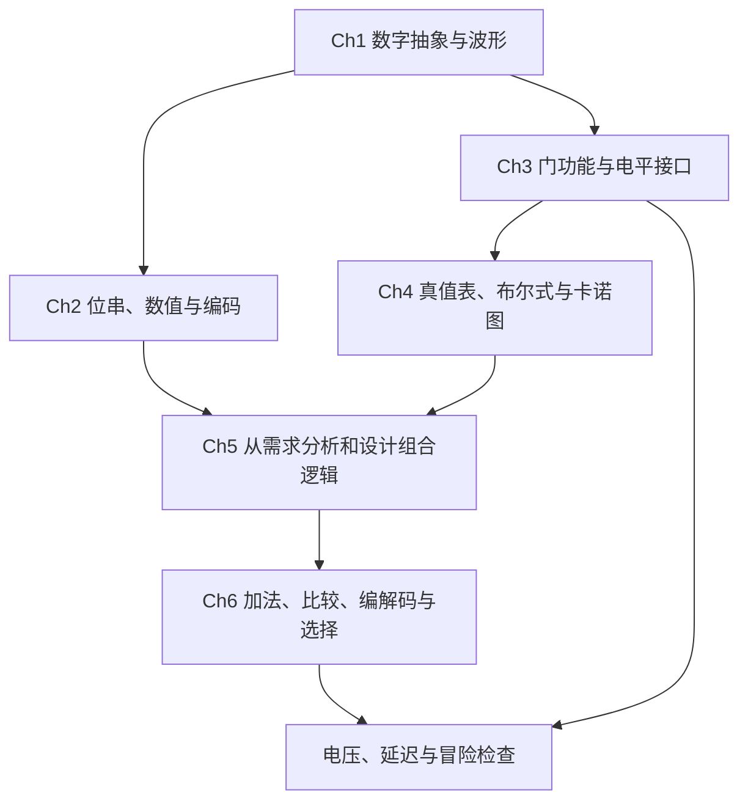

---
tags:
  - ECE2050
  - review
date: 2026-10-20
updated: 2026-10-20
chapter: Ch1–6
aliases:
  - Midterm Review Guide
  - ECE2050 期中复习总纲
  - 数字逻辑与系统期中原理复习
---

# Midterm Review Guide · 期中原理复习总纲

> [!SUMMARY] Scope · 范围与用法
> 本次期中范围为 **Ch1–6**。先用 [[Midterm Knowledge Outline]] 勾选薄弱点，再按本篇把每个原理讲明白，用 [[Midterm Formula Sheet]] 闭卷默写公式，最后做 [[Midterm Practice and Answers]]。下文连接现有专题笔记，完整推导、门图和课件插图可沿链接展开。
>
> [第 6 章课件 PDF p.2](../ECE2050-Chap6.pdf#page=2) 公告：**11 月 1 日，星期日，18:30–20:00，Liwen Hall；闭卷，可带计算器，不能带书、笔记或公式表。** 结合本学期课件与课程大纲，该日期对应 2026 年；后续安排以课程公告为准。本复习公式表用于考前学习。

## 1 · Knowledge Map · 六章怎样连起来

数字逻辑问题分三层：**表示层**确定每一位的含义；**功能层**确定输入与输出关系；**实现层**检查电平、连线、延迟和毛刺。做题时依次确认这三层。

| 章 | 必须能够独立完成的事 | 课件位置（PDF 页序） |
|---|---|---|
| Ch1 | 解释数字抽象；区别组合与时序；读波形；辨认系统模块与 IC 类型 | p.15–43；概念判断 p.44–48 |
| Ch2 | 进制转换；定宽有符号运算；定点/浮点编解码；BCD、Gray、ASCII、奇偶与 CRC | p.3–71；章末清单 p.72–73 |
| Ch3 | 门的真值表/符号/波形互换；读电压门限与静态传输曲线；算噪声容限 | p.3–23；复习 p.24–25 |
| Ch4 | 把文字变成方程；用定律证明和化简；写标准 SOP/POS；用 K-map 化简 | p.4–61；复习 p.62–63 |
| Ch5 | 分析/设计组合电路；奇偶电路；优先逻辑；全 NAND/NOR 实现与气泡推移 | p.4–31；复习 p.32–33 |
| Ch6 | HA/FA、RCA/CLA、比较器、编解码器、显示、MUX/DEMUX、三态与延迟冒险 | p.5–54；复习 p.55–56 |

**范围边界：** Ch1 提到触发器、寄存器、计数器、状态机和存储器时，应认识其功能与“有状态”含义；Ch7–11 的详细激励表、状态机设计、时序约束及存储扩展不作为本篇期中主线。乘法器由 Ch6 p.55 的问题延伸，也是旧卷题型，需要掌握部分积与 HA/FA 的连接思路。

## 2 · Ch1: Digital Foundations · 数字基础与系统观

阅读：[[Digital Foundations and Waveforms]]。

### 2.1 数字抽象、逻辑值与有效极性

模拟量 (analog quantity) 的信息可连续变化；数字量 (digital quantity) 的信息取离散值。导线上的实际电压仍连续变化，接收器通过电压门限解释为 0 或 1。这就是数字抽象 (digital abstraction)。

正逻辑 (positive logic) 把 HIGH 对应到 1、LOW 对应到 0。低有效 (active-low) 描述“何时执行功能”：例如低有效使能端为 0 时器件工作。**低有效控制可以处在正逻辑系统中。** 门符号上的小圆圈、信号名上的横线通常提示反相/低有效语义。

### 2.2 组合、时序与常用模块

组合逻辑 (combinational logic) 稳定后的输出只由当前输入决定，如加法器、比较器、编码器、译码器和数据选择器。时序逻辑 (sequential logic) 保存状态，输出或后续行为与历史有关，如触发器、寄存器、计数器和有限状态机。

| 模块 | 它解决什么问题 |
|---|---|
| Adder · 加法器 | 两个数及可选进位相加 |
| Comparator · 比较器 | 相等、大小判断 |
| Encoder / decoder · 编码/译码器 | 有效线路与代码互换 |
| MUX / DEMUX · 选择/分配器 | 多选一、一路分配到某路 |
| Flip-flop / register · 触发器/寄存器 | 一位/多位信息的保存 |
| Counter / FSM · 计数器/状态机 | 记录次数/记录与控制当前状态 |

### 2.3 波形与复杂系统设计

周期 (period) 是相邻同类边沿的间隔；频率 (frequency) 是每秒周期数；占空比 (duty cycle) 是一个周期内有效脉冲时间的比例。上升/下降时间描述边沿过渡，传播延迟描述输入变化到输出响应；这些量不可互相替代。常见 10%–90%、50% 交点是测量约定，读题时按指定约定使用。

抽象 (abstraction) 隐藏低层细节；约束 (discipline) 保证接口一致；层次化 (hierarchy) 把系统分层；模块化 (modularity) 明确定义接口；规则性 (regularity) 复用重复结构。例如，重复一位全加器构成多位加法器。

集成电路 (integrated circuit, IC) 可按固定功能 (fixed-function) 与可编程逻辑 (programmable logic) 区分；封装安装方式有通孔 (through-hole) 与表面贴装 (surface mount)。SSI/MSI/VLSI/ULSI 是集成规模分类。课件给出的示例是 SSI 少于 10 个门、MSI 10–100 个门、VLSI 10,000–100,000 个门、ULSI 多于 100,000 个门；这是课件的分类口径。可编程类型认识 SPLD、CPLD、FPGA，并理解图形输入或 VHDL 描述经工具实现到器件的过程即可。

**闭卷检查：** 能否解释“数字电路的电压只能是 0 V 或电源电压”为何不成立？能否用一句话区分 adder 与 counter？

## 3 · Ch2: Representation and Coding · 数值表示与编码

### 3.1 位权、转换与位宽

阅读：[[Number Systems and Base Conversion]]。

位置记数法 (positional number system) 用“数字 × 对应位权”求和。小数点左边位权为基数的非负整数次幂，右边为负整数次幂。进制改变保留数值；编码改变位串的解释规则。

- 整数十进制转基数 R：反复除 R，余数**倒序**读。
- 小数十进制转基数 R：反复乘 R，取整数部分，**正序**读；不能有限表示时需说明保留位数和舍入方式。
- 二进制与八/十六进制互转：以小数点为界，整数向左分组、小数向右分组，每组分别 3/4 位；在两端补零，不移动小数点。
- n 位无符号数有 2ⁿ 个码，最大值为 2ⁿ−1。表示 0 到 M 要计算 **M+1 个值** 所需位数。
- 1 byte = 8 bits，1 nibble = 4 bits；十六进制的一位对应 4 bits。题目里的 K/M 若指 2 的幂，需与十进制单位区分。

### 3.2 原码、补码与算术

阅读：[[Binary Arithmetic and Signed Representation]]。

同一位串必须先确定位宽 (width)、无符号/有符号解释 (unsigned/signed) 与编码。原码 (sign-magnitude) 把符号和幅度分开，有 +0 和 −0，不能直接把符号位当普通位相加。二进制补码 (two's complement) 把最高位设为负权，统一使用加法器，并只有一个零。

**补码为何能做减法？** n 位电路只保留模 2ⁿ 的低 n 位，而 −B 与 2ⁿ−B 同余，因此 A−B 可以用 A+反码(B)+1 实现。把每位取反再加最低位的 1，是定宽求相反数的操作。

**进位 (carry) 与溢出 (overflow) 的区别：** 无符号加法看最高位进位；补码加法看数学结果是否超出补码范围。同号相加变异号说明有符号溢出；异号相加不会有符号溢出。减法应使用自己的符号判据或按加法器的进位关系检查，不能只看被减数与最终结果是否同号。

**位宽与符号扩展 (sign extension)：** 无符号扩宽补 0，补码扩宽复制符号位。两个 n 位整数的完整乘积最多需 2n 位。先求幅值、按符号规则确定乘积/商的正负，再编码，是小题可靠的方法。整数除法同时交付商和余数，检查被除数 = 除数 × 商 + 余数；除数为零与最小补码除以 −1 是边界情况。

偏置表示 (biased representation) 另有规则：**存储的无符号码 = 真值 + bias**，解码时减去 bias。它不是整字补码。

### 3.3 定点、量化与饱和

阅读：[[Fixed-Point and Floating-Point Numbers]]。

定点数 (fixed-point number) 本质是整数乘固定尺度。若小数位为 b，最低位步长为 2⁻ᵇ。课程中 U a.b 无符号，Q a.b 为补码有符号，且 **a 包括符号位**，总位数均为 a+b。

相加前对齐小数位；相乘时小数位数相加。丢弃小数位会量化 (quantization)，须区分截断和舍入。回绕 (wraparound) 保留低位可能使正大数突然变负或变小；饱和运算 (saturating arithmetic) 则将越界结果钳到最大/最小可表示值。饱和改变了算术规则，但可避免音频爆音、图像亮点变暗等突变。

### 3.4 IEEE 754 单精度

阅读：[[Fixed-Point and Floating-Point Numbers]]。

浮点数 (floating-point number) 用符号、有效数字和指数表示二进制科学计数法。binary32 的 32 位为 **1 位符号 s、8 位偏置指数字段 E、23 位小数字段 F**；正规数 (normal number) 有隐含前导 1，因此有 24 位有效二进制精度。

编码顺序：取符号 → 幅值转二进制 → 规格化为 1.f×2ᵉ → 算 E=e+127 → 存 f 并按要求舍入。解码必须**先检查 E 是否全 0 或全 1**。零、次正规数 (subnormal)、无穷 (infinity)、NaN 有专门规则，不能一概恢复前导 1。表示范围大不代表能精确表示每一个实数。

### 3.5 BCD、Gray 与字符

阅读：[[Data Coding and Character Representation]]。

8421 二进制编码十进制 (binary-coded decimal, BCD) 把每个十进制数字独立编码成四位，合法码为 0000–1001。例如十进制 14 的 BCD 是 `0001 0100`，普通二进制是 `1110`。BCD 加法逐十进制位相加：原始和大于 9 **或产生四位进位**，就加 `0110` 修正；修正量来自 16 个二进制码与 10 个十进制数字之间的差。

反射格雷码 (binary-reflected Gray code) 相邻代码只有一位变化，能减轻相邻位置切换时的多位歧义；它不直接采用普通二进制位权。二进制转 Gray 用相邻二进制位异或；Gray 转二进制从最高位开始做累积异或。单比特相邻性质不等于校验或纠错能力。

ASCII (American Standard Code for Information Interchange) 为 7 位字符编码，共 128 个码。记住字符 `'0'` 的码为 0x30、`'A'` 为 0x41、`'a'` 为 0x61；字符 `'5'` 与整数 5 的存储值不同。BCD 表示十进制数字，ASCII 表示字符，两者用途不同。

### 3.6 奇偶校验与 CRC

阅读：[[Parity and Cyclic Redundancy Checks]]。

奇偶校验 (parity) 对数据加一位，使整个码组里 1 的个数保持偶数或奇数。数据异或结果为 1 表示数据中有奇数个 1。校验能检测任意奇数个位翻转；偶数个位翻转可能漏检，无法仅凭一位校验确定出错位置。

循环冗余校验 (cyclic redundancy check, CRC) 把位串看成 GF(2) 上的多项式，除法用 XOR，无进位和借位。生成码有 r+1 位且最高位为 1，则次数为 r：数据末尾先补 **r 个 0**，求余数并补足 r 位，再把余数接到原数据后。接收端整段相除，余数非零则发现错误；余数为零只说明未检出错误。检错保证取决于生成多项式，不能泛称“可检测全部多位错误”。

**闭卷检查：** 给定 `1101 0110`，能分别按 unsigned、sign-magnitude、two's complement 解码吗？能从零写出定点范围、正规浮点公式、Gray 转换和 CRC 补零位数吗？

## 4 · Ch3: Gates and Voltage Interfaces · 门与电平接口

阅读：[[Logic Gates and Boolean Functions]]、[[Logic Levels and Noise Margins]]。

### 4.1 逻辑门的同一个功能有四种表示

熟悉反相器 (inverter/NOT)、缓冲器 (buffer)、AND、OR、NAND、NOR、异或 (exclusive-OR, XOR)、同或 (exclusive-NOR, XNOR) 的 **符号、表达式、真值表、时序波形**。二输入 XOR 判不同，XNOR 判相同；多输入 XOR 判 1 的个数为奇数，不能写成“只要有一个输入为 1”。

分析波形时，以所有输入变化点划分时间区间，逐段算门输出。题目未考虑延迟时按理想模型画；给定延迟时必须沿路径传播，不能把输出变化全放在输入边沿上。

AND 的控制值为 0、非控制值为 1；OR 的控制值为 1、非控制值为 0。这个规律用于门控、故障传播和化简。NAND/NOR 再将输出取反。

### 4.2 门限与噪声容限

VIL(max) 是接收器保证识别 LOW 的最高输入电压；VIH(min) 是保证识别 HIGH 的最低输入电压。VOL(max) 是驱动器输出 LOW 的最坏上界；VOH(min) 是输出 HIGH 的最坏下界。

计算噪声容限 (noise margin) 时，把**驱动器输出保证**与**接收器输入要求**比较；高电平向下退化和低电平向上退化分别预算。两侧都要通过。负容限表示该接口失去最坏条件下的静态保证；落入未保证区不等于已确定翻成另一逻辑值。

静态传输特性 (DC transfer characteristic) 描述稳定输入电压与稳定输出电压的关系。理想对称、轨到轨缓冲器的门限在 VDD/2；真实门必须按给定曲线或参数读数。不能把所有真实器件的门限都设为一半电源电压，也不能由静态曲线直接求传播延迟。

电源缩小通常使可用的绝对电压预算变小；是否兼容仍要逐侧计算。课件的家族参数是给定工作条件下的示例，不能由名称推断所有器件的值。扇出 (fan-out) 指规定条件下能驱动的负载数量上限，电压判断之外还受驱动能力与负载影响；它在旧卷中出现，可作为补充概念复习。

**闭卷检查：** 能否说明为何用 VDD−VIH 算噪声容限一般不对？为何 TTL→LVCMOS 与 LVCMOS→TTL 必须分开算？

## 5 · Ch4: Boolean Algebra and K-Maps · 布尔代数与卡诺图

阅读：[[Boolean Algebra and Circuit Models]]、[[Boolean Forms and Algebraic Simplification]]、[[Karnaugh Map Minimization]]。

### 5.1 先建立组合电路模型

组合电路由组合元件组成；每个内部节点有唯一驱动；不含有向反馈环。输入/输出节点、内部节点和连线表示不同角色。三态总线在“最多一个有效驱动器”的额外约束下使用，不能据此任意并接普通逻辑门输出。

布尔变量取 0/1；字面量 (literal) 是变量或其反；乘积表示 AND，和表示 OR，横线表示 NOT。运算通常按 NOT → AND → OR 解释，横线范围和括号会改变含义。

### 5.2 定律与证明

必须会用交换律 (commutative)、结合律 (associative)、分配律 (distributive)、幂等律 (idempotent)、互补律 (complement)、吸收律 (absorption)、德摩根定律 (DeMorgan's theorems)。特别熟练：合并只差一个变量的项、吸收包含关系、去掉冗余共识项。

完全归纳/穷举证明 (perfect induction/proof by exhaustion) 检查每一组输入，是小规模函数的独立验证方法。对偶 (duality) 同时交换 AND↔OR、0↔1，保留变量及其反；**求对偶与给整个表达式取反是两个操作。**

### 5.3 标准式与一般式

最小项 (minterm) 是对某一行输入恰好为 1 的乘积项，所有变量各出现一次。最大项 (maxterm) 是对某一行恰好为 0 的和项，也含所有变量。标准 SOP 收集输出 1 的各行，标准 POS 收集输出 0 的各行。变量顺序决定行号，例如 ABCD 中 A 为最高位。

一般积之和 (sum of products, SOP) 与和之积 (product of sums, POS) 不要求每项含全体变量；标准式 (canonical/standard form) 才要求。题目要 standard 时，最简式不能直接代替标准式。补全缺失变量可分别使用 P=P(X+X̄) 与 S=(S+X)(S+X̄)。

### 5.4 卡诺图为何能消变量

卡诺图 (Karnaugh map, K-map) 用 Gray 顺序排格，使邻格只差一个变量。两个只差 X 的最小项相加时 X+X̄=1，故 X 消失；合并 2ᵏ 格可消去 k 个变量。

1. 明确变量顺序，行列按 `00,01,11,10` 排列。
2. SOP 圈 1、POS 圈 0；每组格数为 1、2、4、8…，必须是合法相邻矩形。
3. 上下边、左右边可首尾相邻，四角可构成一组；对角线不相邻。
4. 允许重叠；每个要求的 1/0 必须覆盖。先识别只能由某个质蕴涵项覆盖的必要格，再选尽量大的组合。
5. SOP 保留不变的变量：固定 1 写原变量，固定 0 写反变量；POS 相反。
6. 无关项 (don't-care, X) 可按有利方式取 0/1，也可不用；不要求覆盖 X。
7. 比较候选覆盖的项数和字面量数，并验证所有规定输入；最小答案可能不唯一。

**关键条件：** BCD 的 10–15 只有在规格允许时才是 X。如果无效输入出现时要求输出 0，这些格必须填 0，原来的最简函数可能需要修改。逻辑最小化与消除冒险也不总得到同一电路。

## 6 · Ch5: Combinational Analysis and Design · 组合分析与实现

阅读：[[Combinational Logic Analysis and Design]]、[[Universal Gates and Bubble Pushing]]、[[Digital Logic Troubleshooting]]；奇偶电路回看 [[Parity and Cyclic Redundancy Checks]]。

### 6.1 从电路分析，从规范设计

**分析路径：** 标内部节点 → 自输入向输出逐门写式 → 化简 → 真值表/波形核验。先保留电路结构的括号，避免过早展开而丢失反相范围。

**设计路径：** 定义变量与有效极性 → 明确 exactly、at least、priority、invalid 等约束 → 真值表 → 标准式 → 化简 → 选择门或功能块 → 检查极性、位宽、延迟。

“四输入恰有三个 1”不包括 1111；“至少三个 1”包括。对四位并行输入寻找连续 `110`，只需检查两个相邻三位窗口，是组合问题；随时间一位一位识别序列则需状态，不能混用模型。

### 6.2 常见结构与优先电路

AND-OR 实现 SOP；AND-OR-Invert (AOI) 将整个 SOP 取反，并可由德摩根改写为 POS。OR-AND 实现 POS。XOR 链用于奇偶发生器与检查器。电路的“多级”按实际门结构判断；输入反相器是否计入级数，以题目口径为准。

优先逻辑 (priority logic) 在多个请求同时出现时只接受最高优先级请求。较低优先级请求成立的条件要包含“所有更高请求都未成立”。没有输入有效与第 0 路有效可能给同一代码，需要 valid 位区分。

### 6.3 通用门、双重符号与气泡推移

NAND 和 NOR 都是通用门 (universal gates)，各自能实现 NOT、AND、OR，因而能构造任意布尔函数。全 NAND 实现通常从 SOP 出发；全 NOR 实现通常从 POS 出发。

气泡推移 (bubble pushing) 的依据是德摩根：穿过门体移动反相时，AND↔OR，并对相关输入/输出同时改变气泡；同一路上相邻的两次反相相消。NAND 的等价双重符号是**输入带气泡的 OR（negative-OR）**；NOR 对应 negative-AND。

需要反变量而题目没有提供时，应加入反相器或同输入 NAND/NOR。多输入 NAND/NOR 与串联二输入门的功能不能直接视为相同；拆门时必须重新检查反相。

### 6.4 故障与波形（作业/旧卷补充）

固定为 0/1 故障 (stuck-at fault) 测试有两步：用相反值**激活**故障；让后续门输入处于非控制值，以把差异**传播**到输出。检测到异常与唯一定位故障是两种目标。断路 (open circuit) 的输入状态需要题目给定的电气模型，不能一律当 0 或 1。

## 7 · Ch6: Building Blocks and Timing · 功能块与时序

### 7.1 半加器、全加器与多位加法

阅读：[[Binary Arithmetic Circuits]]；课件 p.5–17。

半加器 (half adder, HA) 加两个位，输出 sum 与 carry；全加器 (full adder, FA) 还要接收 carry-in。两个 HA **再加一个 OR** 可构成 FA。输出是有位权的一对，需满足输入位之和 = sum + 2×carry。

多位加法器按位对齐，低位进位接高位进位输入。两个 74HC283/74LS283 可级联实现八位加法；最终 carry-out 是完整无符号和的额外高位。六路投票计数可用 HA/FA 逐步相加；0–6 共七个结果，需三位输出，进位必须接到正确权重的一列。

串行进位加法器 (ripple-carry adder, RCA) 的最坏进位逐级传递；超前进位加法器 (carry look-ahead adder, CLA) 展开生成/传播关系以减少逐级等待。本课件定义生成 Gᵢ=AᵢBᵢ、传播 Pᵢ=Aᵢ+Bᵢ。XOR 传播也能用于进位公式，但 **OR 传播不能代入 Sᵢ=Pᵢ⊕Cᵢ**；sum 仍用 Aᵢ⊕Bᵢ⊕Cᵢ。块内超前、块间串行仍含跨块的 ripple 路径。

乘法器 (combinational multiplier) 先由 AND 生成部分积，再按同一权重逐列相加；HA 接两个位，FA 接三个位，carry 移到下一权重。若题目仅允许 FA，令 FA 的一个输入为 0 可代替 HA。延迟需沿实际依赖路径累计，不能把所有加法器数目直接相加。

### 7.2 比较器

阅读：[[Comparison Decoding and Selection]]；课件 p.19–23。

相等比较逐位 XNOR 后 AND。无符号大小比较从最高位开始，第一个不同位决定大小；低位只有在所有更高位相等时才起作用。A>B、A=B、A<B 三个输出在有效输入下应恰有一个成立。

74HC85/74LS85 扩展时低位块结果送入高位块级联输入；最低块的初始条件为 EQ=1、GT=LT=0。比较有符号补码时先处理符号，不能直接套无符号比较器解释。

### 7.3 编码器、译码器及扩展

阅读：[[Comparison Decoding and Selection]]；课件 p.25–35。

译码器 (decoder) 把 n 位代码转成至多 2ⁿ 根选中线路；有效且使能时，one-hot/one-cold 输出只有一根有效。高有效译码输出是最小项，接 OR 实现 SOP；低有效输出是最小项的反，应接 NAND 合成相同函数。

编码器 (encoder) 把有效输入线路转成代码；普通编码器通常要求输入 one-hot。优先编码器 (priority encoder) 规定同时有效时谁优先。74HC147 是十进制到 BCD 的优先编码器，输入低有效、输出为互补 BCD；要区分引脚号、十进制数字与输出位权。

74HC154 是 4-to-16 低有效输出译码器，两个外部低有效片选都为 LOW 才使能；课件内部 EN 为 HIGH 表示组合后的使能条件。用两片扩展 5-to-32 时共享低四位，由最高位 A₄ 选择低/高半区，未使能的芯片全部输出 HIGH。不能把两片普通推挽输出直接短接。

### 7.4 七段显示与消零

阅读：[[Seven-Segment Display and Code Conversion]]；课件 p.36–37，并联系 Ch4 p.60–61。

七段显示 (seven-segment display) 先确定某数字应点亮哪些段，再按共阳/共阴和输出极性确定 0/1。以课件 74LS47 类低有效输出、共阳显示为例，LOW 点亮，HIGH 熄灭。段函数的卡诺图是每一段各自的布尔设计。

灯测试 (lamp test, LT)、消隐 (blanking input, BI)、逐级消隐输入/输出 (ripple blanking input/output, RBI/RBO) 覆盖普通译码，必须按真值表控制。课件条件下，BCD=0000 且 RBI=LOW 可把该零消隐并使 RBO=LOW；正常非零会停止逐级消零。前导零与尾随零按不同方向级联，内部有意义的零必须保留；例如 `0030.0800` 可显示为 `30.08`。

### 7.5 MUX、DEMUX 与三态

阅读：[[Comparison Decoding and Selection]]、[[Tri-State Buffers and Bus Drivers]]；课件 p.39–45。

多路选择器 (multiplexer, MUX) 把某一路数据送到公共输出，N=2ˢ 路需要 s 位选择。解复用器 (demultiplexer, DEMUX) 把一个数据送到被选中的输出；其余输出保持不有效。

**MUX 实现函数：** 选择变量固定后，数据端接对应的余因子 (cofactor)。用 n 个选择位实现 n 变量函数时，数据端直接填真值表 0/1；只用 n−1 个选择位时，剩余变量的四种余因子是 0、1、X、X̄。务必标清 S₁S₀ 与 I₀…I₃ 的顺序、使能极性和反相输出。

三态缓冲器 (tri-state buffer) 在不使能时输出高阻 (high impedance, Z)，不是逻辑 0。多个缓冲器共用总线时必须至多一个有效驱动；全关闭时可能浮空，两个相反值同时驱动会产生争用 (contention)。

### 7.6 延迟、关键路径与冒险

阅读：[[Propagation Delay and Logic Hazards]]；课件 p.47–54。

传播延迟 (propagation delay, tpd) 限定最晚稳定时间；污染延迟 (contamination delay, tcd) 限定最早可能变化时间。按题目给定门延迟模型，把同一路径的延迟相加，在所有相关路径中分别取最大/最小；关键路径 (critical path) 是累计最大传播延迟的路径。物理上还应注意路径能否被输入条件激活。

冒险 (hazard) 是路径延迟不同造成的毛刺 (glitch)。静态 1 冒险本应保持 1 却短暂到 0，常发生在两项通过某变量与其反分别覆盖相邻状态时。加入不依赖切换变量的共识项 (consensus term) 可搭桥；静态 0 冒险有对偶形式。

课件例子 F=ĀB̄+BC：当 A=0、C=1、B 切换时，输出应为 1，但两条路可能短时都为 0；加 ĀC 可消除此单输入切换下的静态 1 冒险。共识项不改变稳态真值表，却可改变动态行为。多输入同时变化还可能产生别的毛刺，不能由这一项保证全部消除。

“同步设计中毛刺可容忍”依赖稳定采样等条件；毛刺若进入时钟、异步控制或被中途采样，仍可能出错。本次先掌握组合稳定时间与毛刺原因，完整建立/保持分析留到 Ch9。

## 8 · Source Corrections · 容易照抄错的地方

下表是对本地原文件逐页核对并按定义重新计算的结果，未改动原课件或试卷。

| 来源 | 容易误记的内容 | 按定义复核的结果 |
|---|---|---|
| [Ch2 p.54](../ECE2050-Chap2.pdf#page=54) | Q1.15 范围写成 `(1, -1]` | 本课 a 含符号位：**[−1, 1−2⁻¹⁵]** |
| [Ch2 p.60](../ECE2050-Chap2.pdf#page=60) | 指数范围写成 [−127,+128]，且称 biased exponent | 存储字段 E 为 0–255；正规数只用 E=1–254，实际指数 **e=−126…127**；两端字段另有用途 |
| [Ch2 p.71](../ECE2050-Chap2.pdf#page=71) | G=`1010` 却补 4 个零、用 4 位余数 | 次数为 3，应补 **3** 个零；D=`11010011` 时余数 **010**，发送 **11010011010**；生成式常数项为 0 也不是常用 CRC 的理想选择 |
| [2025 Q1(5)，p.1](../LGU_HUB_ECE2050/Midterm2025withSolution.pdf#page=1) | 判 Y 后又写奇校验位 0 | `00010100` 有两个 1，奇校验位应为 **1**；Y 的判断正确，后面的 0 不一致 |
| [2025 Q2(2)，p.2](../LGU_HUB_ECE2050/Midterm2025withSolution.pdf#page=2) | 文字写 13−(−10)=23 | `00001100` 是 12，故结果为 **22=`00010110`**；题解的二进制结果正确 |
| [2025 Q2(3)，p.2](../LGU_HUB_ECE2050/Midterm2025withSolution.pdf#page=2) | 把被丢弃的 carry=1 解释成结果正号 | 补码符号看**保留字的最高位**；额外进位不能普遍判断符号 |

补充辨析：Ch3 p.19 的“两个容限均小于 VDD/2”须结合图示的门限和输出假设理解，通用接口判断始终使用四个保证限值；CLA 的 OR/XOR 传播定义是两种约定，不是其中一种一定错误。

CRC 的版本/格式也需分清：Ch2 p.71 的四位扩展帧 `110100110100` 本身同样能被 G 整除，但它使用补四个零、四位余数栏，与标准 degree-r 的三位 CRC 格式不同。上表按“生成码位数减一”的规则重算；若题目明确另给补零位数或帧格式，应遵循题面并说明约定。详见 [[Parity and Cyclic Redundancy Checks]]。

## 9 · Study Route · 从现在到考试的复习顺序

| 日期 | 重点与完成标准 |
|---|---|
| 10/20 | Ch1–2 数制和整数：能不看笔记解释位宽、符号、进位/溢出，并完成自测 1–7 |
| 10/21 | 定点/浮点：能独立编码一个负定点数、一个负浮点数，并识别特殊字段 |
| 10/22 | BCD/Gray/奇偶/CRC：能完整执行算法并反向验证 |
| 10/23 | Ch3：门、波形、电平与噪声预算；逐项写出公式的发送端/接收端 |
| 10/24 | Ch4：定律证明、标准 SOP/POS，变量顺序始终写在草稿首行 |
| 10/25 | K-map：圈 1、圈 0、首尾相邻、X 的使用；比较不同合法最小解 |
| 10/26 | Ch5：文字设计、优先逻辑、全 NAND/NOR、气泡推移和故障题 |
| 10/27 | Ch6：HA/FA、RCA/CLA、比较器与乘法器；按位权连线 |
| 10/28 | 编解码、显示、MUX/DEMUX、三态；每题标清有效极性 |
| 10/29 | 延迟、关键路径、冒险；完成自测 31–33 并复做全部错题 |
| 10/30 | 限时 90 分钟做一份旧卷；按题意与原始定义核对，不依赖旧答案的一致性 |
| 10/31 | 闭卷重写公式表；仅重做错题和解释不清的原理，整理易错条件 |
| 11/1 | 考前短回忆：范围、编码、极性、标准式、CLA、CRC、路径；按课程公告赴考 |

每天的基本循环：**先闭卷回忆 10 分钟 → 针对薄弱点读专题 → 独立做题 → 用另一种表示验证 → 把错误归到定义/计算/条件/读题。** 公式表遮住右侧条件也要能补出来。自测覆盖六章概念，不等同于一份 90 分钟模拟卷。

## 10 · Source Map · 资料与使用边界

本篇依据当前学期六章课件的章节复习清单与正文，不只按旧卷反推范围。页码为 **PDF 的第几页**。

- [本学期课程大纲](../ECE2050%20Course%20Outline_AY26-27%20T1.pdf#page=2)，p.2–3 课程内容、p.5–6 教学计划；当前课件中的具体考试公告更明确。
- [Ch1: Introductory Concepts](../ECE2050-Chap1(1).pdf)，p.15–43，章末 p.43–48。
- [Ch2: Number Systems](../ECE2050-Chap2.pdf)，p.3–71，章末 p.72–73。
- [Ch3: Logic Gates](../ECE2050-Chap3.pdf)，p.3–23，章末 p.24–25。
- [Ch4: Boolean Algebra and Logic Simplification](../ECE2050-Chap4.pdf)，p.4–61，章末 p.62–63。
- [Ch5: Combinational Logic Design](../ECE2050-Chap5.pdf)，p.4–31，章末 p.32–33。
- [Ch6: Combinational Building Blocks](../ECE2050-Chap6.pdf)，公告 p.2、正文 p.5–54、章末 p.55–56。
- [HW1](../HW1.pdf)、[HW2](../HW2.pdf) 是本学期练习覆盖的补充依据；自测是学习用重组和推导，未作为作业提交稿。
- [2023 期中](../LGU_HUB_ECE2050/Midterm2023withSolutions.pdf)、[2024 期中](../LGU_HUB_ECE2050/Midterm2024withSolutions.pdf)、[2025 期中](../LGU_HUB_ECE2050/Midterm2025withSolution.pdf) 只用于题型索引和交叉练习；不是本次命题预测。题型与页码见 [[Midterm Practice and Answers]]。

---
索引：[[ECE2050.1]] · [[Glossary]]
